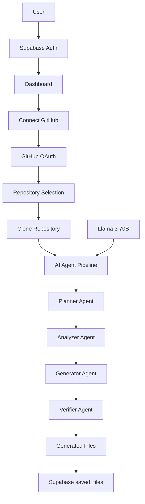

# InfraMind Architecture Overview

## 🏗️ System Architecture

InfraMind uses a clean separation of concerns with distinct services handling different aspects of the platform:

### Authentication vs Repository Access

**IMPORTANT DISTINCTION:**
- **User Authentication**: Handled by Supabase Auth (login/signup/sessions)
- **Repository Access**: Handled by GitHub API service (repo discovery/cloning)

These are TWO SEPARATE systems working together!

> **History:** User authentication and saved files used Appwrite until October 2026, then moved to Supabase. No Appwrite code or configuration remains.

## 🔐 Authentication Layer (Supabase Auth)

### Purpose
- User registration and login
- Session management (in the browser, via `@supabase/supabase-js`)
- OAuth integration for user authentication

### Features
- Email/Password authentication (optionally with email confirmation)
- Google OAuth
- GitHub OAuth (for user login)
- Profile fields (name, avatar, GitHub username) read from the Supabase user's metadata

### Implementation
- `client/src/lib/supabase.ts` creates the Supabase client and wraps sign-in, sign-up and sign-out
- `client/src/contexts/AuthContext.tsx` loads the current session on startup and subscribes to auth changes (OAuth returns, token refreshes, sign-outs)
- After OAuth, Supabase redirects the user to `<app origin>/dashboard`

### Environment Variables (frontend only)
```bash
VITE_SUPABASE_URL=https://your-project-ref.supabase.co
VITE_SUPABASE_ANON_KEY=your-supabase-publishable-or-anon-key
```
The Express server needs no Supabase variables.

### OAuth Callback URLs
- Google and GitHub (configured at the provider): `https://<project-ref>.supabase.co/auth/v1/callback`
- App redirect URLs (Supabase → Authentication → URL Configuration): `http://localhost:5173/**` for local development, plus your production frontend URL

## 🗄️ Data Layer (Supabase PostgreSQL)

### `public.saved_files`
| Column | Type | Notes |
|--------|------|-------|
| `id` | `uuid` | Primary key, `gen_random_uuid()` |
| `user_id` | `uuid` | References `auth.users(id)`, cascades on delete |
| `name` | `text` | File name, e.g. `Dockerfile` |
| `type` | `text` | e.g. `dockerfile`, `github-actions`, `env` |
| `repo_url` | `text` | Nullable |
| `content` | `text` | Full file content |
| `created_at` | `timestamptz` | Defaults to `now()` |

Indexed on `(user_id, created_at desc)`.

### Row Level Security
RLS is enabled. Policies allow a signed-in user to `select`, `insert` and `delete` only rows where `user_id = auth.uid()`. There is no `update` policy. The browser queries the table directly with the publishable (anon) key plus the user's session, and the policies keep users separated. Code: `SavedFilesAPI` in `client/src/lib/api.ts`.

## 🐙 GitHub Integration Layer

### Purpose
- Repository discovery and access
- Clone repositories for analysis
- Fetch user's repositories and organizations
- Handle private repository access

### Why Separate from Supabase Auth?
- Supabase OAuth is for USER authentication
- GitHub API access is for REPOSITORY operations
- Users need fine-grained repo permissions
- Enables access to private repositories

### Environment Variables
```bash
GITHUB_CLIENT_ID=your-github-oauth-app-client-id
GITHUB_CLIENT_SECRET=your-github-oauth-app-secret
GITHUB_REDIRECT_URI=https://your-backend.com/auth/github/callback
JWT_SECRET=your-jwt-secret
```

### OAuth Callback URL
- GitHub OAuth App: `https://your-backend.com/auth/github/callback`

## 🤖 AI Processing Layer

### Multi-Agent System (Sequential Pipeline)
- **Planner Agent**: Repository structure analysis
- **Analyzer Agent**: Tech stack detection
- **Generator Agent**: CI/CD file creation
- **Verifier Agent**: Configuration validation

`createAgentWorkflow()` in `server/agents/index.js` awaits the four agents in a fixed order: planner → analyzer → generator → verifier. They pass a single `AgentState` object along. No LangGraph or other orchestration library is used, and nothing runs in parallel.

### AI Services
- **Llama 3 70B** (Novita.ai): Core AI reasoning for all four agents
- **Tavily API**: Real-time documentation search (legacy generator only)
- **Mem0**: User interaction memory (legacy generator only)
- **Keywords AI**: Observability (legacy generator only, optional)

The legacy generator is `devPilotAI` in `server/index.js`. It runs only for `POST /api/devpilot` with `useAgents: false`, which the web client never sends.

### Environment Variables
```bash
LLAMA_API_KEY=your-novita-ai-key          # required
TAVILY_API_KEY=your-tavily-key            # optional: legacy generator only
MEM0_API_KEY=your-mem0-key                # optional: legacy generator only
KEYWORDS_AI_API_KEY=your-keywords-ai-key  # optional: legacy generator only
```

## 🔄 Complete User Flow

### 1. User Authentication (Supabase Auth)
```
User → Login/Signup → Supabase Auth (→ Google/GitHub → Supabase callback) → /dashboard
```

### 2. GitHub Repository Connection
```
User → Connect GitHub → GitHub OAuth → Repository Access
```

### 3. Repository Analysis
```
Select Repo → Clone → AI Analysis → Generate Files
```

### 4. Real-time Updates
```
Clone (10%, 25%) → Analysis start (30%) → Pipeline result → Completion (100%)   [Socket.IO "progress" events]
```

### 5. Saving Generated Files
```
Generated File → Save → Supabase saved_files (RLS) → Saved Files list → Download
```

## 📊 Data Flow



## 🌐 Deployment Architecture

### Frontend (Vercel)
- React application
- Environment variables for Supabase (`VITE_SUPABASE_URL`, `VITE_SUPABASE_ANON_KEY`) and API URLs
- Static asset serving

### Backend (Render)
- Node.js Express server
- WebSocket support for real-time updates
- All environment variables configured
- Note: `render.yaml` currently starts `test-render.js` (a smoke-test stub), not `server.js`. See DEPLOYMENT-GUIDE.md

### API URL
- The frontend reaches the server through `VITE_API_URL`. `VITE_SERVER_URL` is read only by the unused `client/src/lib/agentApi.ts`

### External Services
- **Supabase**: Authentication and PostgreSQL database
- **GitHub**: Repository access and OAuth
- **Novita.ai**: AI model hosting
- **Tavily**: Search API
- **Mem0**: Memory storage

## 🔧 Environment Setup Checklist

### Supabase Project
- [ ] Create project at supabase.com
- [ ] Copy Project URL and publishable (anon) key into `VITE_SUPABASE_URL` / `VITE_SUPABASE_ANON_KEY`
- [ ] Run the `saved_files` table + RLS SQL (see DEPLOYMENT-GUIDE.md)
- [ ] Set Site URL and Redirect URLs (local and production)
- [ ] Enable Google and GitHub providers with callback `https://<project-ref>.supabase.co/auth/v1/callback`
- [ ] Decide whether **Confirm email** stays on for email/password sign-ups

### GitHub OAuth App
- [ ] Create OAuth app in GitHub Developer Settings
- [ ] Set Homepage URL: `https://your-frontend.com`
- [ ] Set Callback URL: `https://your-backend.com/auth/github/callback`
- [ ] Get Client ID and Secret

### API Keys
- [ ] Novita.ai account and API key (`LLAMA_API_KEY`)
- [ ] Tavily API key (optional, legacy generator)
- [ ] Mem0 API key (optional, legacy generator)
- [ ] Keywords AI key (optional, legacy generator)

## 🚨 Common Misunderstandings

### ❌ Wrong: "Remove GitHub OAuth since Supabase handles auth"
- Supabase handles USER authentication
- GitHub OAuth is for REPOSITORY access
- These serve different purposes

### ❌ Wrong: "All environment variables are for authentication"
- Authentication: Supabase variables (frontend only)
- Repository access: GitHub variables
- AI processing: API key variables

### ✅ Correct: Two OAuth Systems
1. **Supabase GitHub OAuth**: User login to the platform (callback on Supabase)
2. **GitHub API OAuth**: Repository access after login (callback on the Express server)

Each one needs its own GitHub OAuth App, because a GitHub OAuth App has only one callback URL.

## 🔍 Debugging Guide

### Authentication Issues
- Check `VITE_SUPABASE_URL` and `VITE_SUPABASE_ANON_KEY` (rebuild the frontend after changing them)
- Verify the Google/GitHub provider is enabled in Supabase with the right client ID and secret
- Ensure the provider's callback is `https://<project-ref>.supabase.co/auth/v1/callback`
- If OAuth lands on the wrong URL, add the app's origin to Supabase Redirect URLs

### Saved Files Issues
- Confirm the `saved_files` table exists and RLS policies are in place
- An empty list or an insert error usually means no active session, or a `user_id` that doesn't match `auth.uid()`

### Repository Access Issues
- Check GitHub OAuth app configuration
- Verify GitHub API scopes (`repo`, `user:email`)
- Test GitHub token permissions

### AI Processing Issues
- Verify API keys are valid
- Check rate limits on external services
- Monitor agent pipeline logs

This architecture ensures security, scalability, and clear separation of concerns while providing a seamless user experience. 