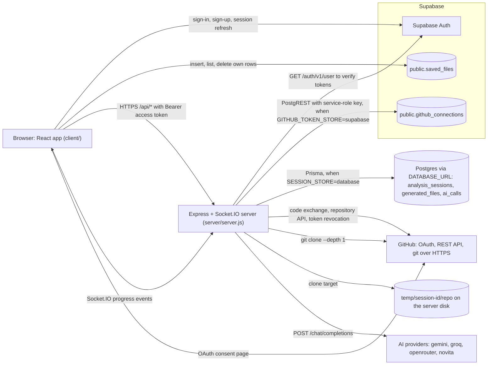
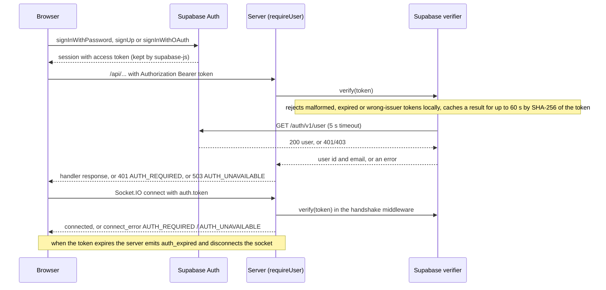
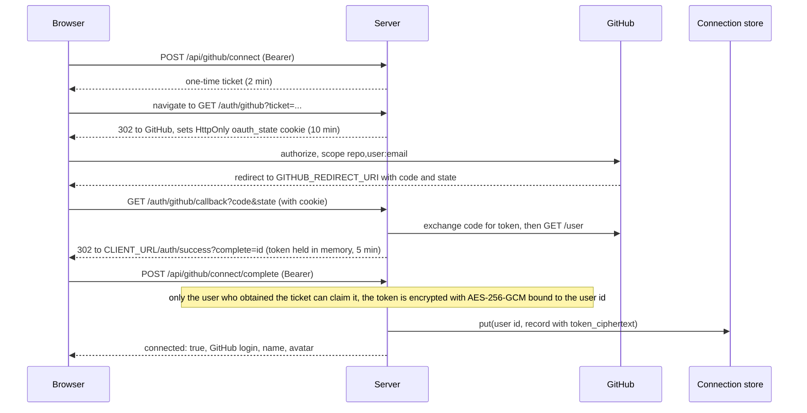
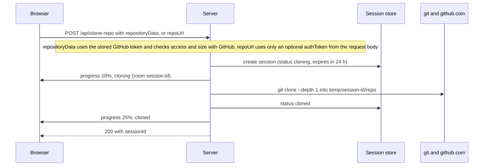
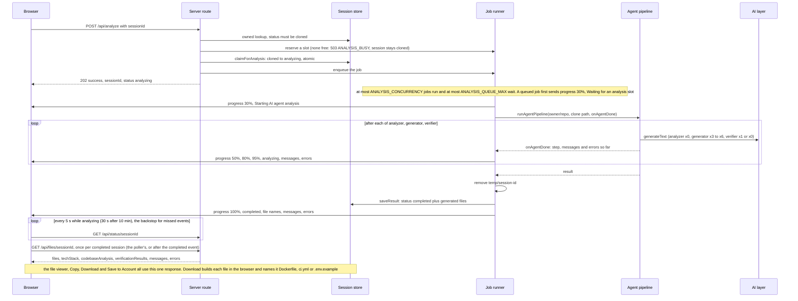
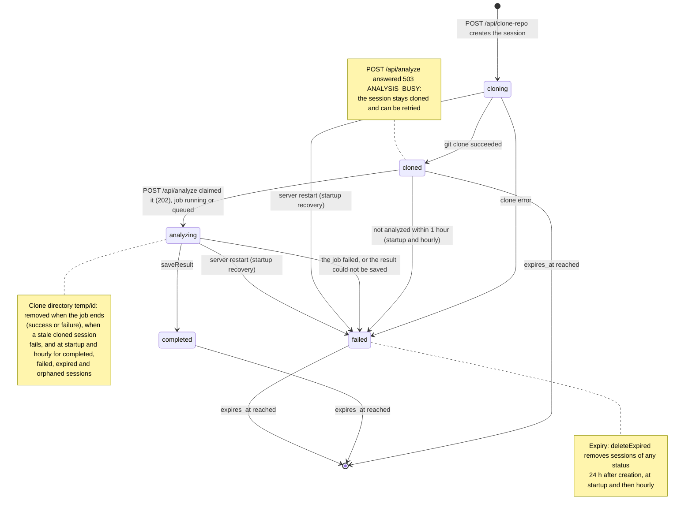

# InfraMind Architecture

InfraMind takes a GitHub repository, clones it on the server, runs three agents in sequence (analyzer, generator, verifier) and produces three files: a Dockerfile, a GitHub Actions workflow and a `.env.example`. This document describes how the parts fit together, as implemented in this repository.

Contents:

1. [System context](#1-system-context)
2. [Sign-in and API authentication](#2-sign-in-and-api-authentication)
3. [GitHub connection](#3-github-connection)
4. [Analysis flow](#4-analysis-flow)
5. [Session lifecycle](#5-session-lifecycle)
6. [Data model](#6-data-model)
7. [AI layer](#7-ai-layer)
8. [Startup checks and configuration](#8-startup-checks-and-configuration)
9. [Code that is not part of the running system](#9-code-that-is-not-part-of-the-running-system)

The agent pipeline and the AI provider fallback have their own diagrams in [README-AI-AGENTS.md](README-AI-AGENTS.md). Deployment is in [DEPLOYMENT-GUIDE.md](DEPLOYMENT-GUIDE.md).

## 1. System context

Source: `server/server.js`, `server/utils/auth.js`, `server/utils/githubConnections.js`, `server/utils/sessionStore.js`, `server/db/client.js`, `server/github.js`, `server/utils/git.js`, `server/ai/client.js`, `server/ai/providers.js`, `client/src/lib/supabase.ts`, `client/src/lib/api.ts`, `client/src/lib/apiClient.ts`, `client/src/components/AgentProgress.tsx`.

Who talks to what:

| Component | Talks to | How |
|---|---|---|
| Browser | Supabase Auth | `@supabase/supabase-js`: email/password, Google and GitHub sign-in (`client/src/lib/supabase.ts`) |
| Browser | `public.saved_files` | Directly, with the anon key and the user's session (`SavedFilesAPI` in `client/src/lib/api.ts`) |
| Browser | Server | `apiFetch` adds `Authorization: Bearer <Supabase access token>` (`client/src/lib/apiClient.ts`); Socket.IO sends the same token in `auth.token` (`client/src/components/AgentProgress.tsx`) |
| Server | Supabase Auth | Verifies every access token with `GET /auth/v1/user` (`server/utils/auth.js`) |
| Server | `public.github_connections` | Only when `GITHUB_TOKEN_STORE=supabase`, through PostgREST with `SUPABASE_SERVICE_ROLE_KEY` (`server/utils/githubConnections.js`) |
| Server | Postgres (`DATABASE_URL`) | Only when `SESSION_STORE=database`, through Prisma (`server/db/client.js`, `server/utils/sessionStore.js`) |
| Server | GitHub | OAuth code exchange, user/repository/organization API calls, token revocation (`server/github.js`); `git clone` over HTTPS (`server/utils/git.js`) |
| Server | AI providers | OpenAI-format `POST {baseUrl}/chat/completions` (`server/ai/client.js`) |

CORS and Socket.IO use one origin list: `CLIENT_URL`'s origin, the entries of `CORS_ALLOWED_ORIGINS`, and `http://localhost:5173` when `NODE_ENV` is not `production` (`readAllowedOrigins` in `server/utils/config.js`). A request from another origin gets no `Access-Control-Allow-Origin` header and is otherwise handled normally; a Socket.IO handshake from another browser origin is refused (`server/server.js`).

## 2. Sign-in and API authentication

User accounts live in Supabase Auth. The browser signs in with Supabase; the server never sees a password. Every `/api/*` route except `/api/metrics` and `/api/analytics` sits behind `requireUser`, which checks the Supabase access token with Supabase itself.

Source: `client/src/lib/supabase.ts`, `client/src/contexts/AuthContext.tsx`, `client/src/lib/apiClient.ts`, `client/src/components/AgentProgress.tsx`, `server/utils/auth.js`, `server/utils/realtime.js`, `server/server.js`.

Details:

- Middleware order for HTTP (`server/server.js`): `trust proxy` (`TRUST_PROXY`, 0-3, never `true`), CORS, security headers, request logging, metrics, then the per-IP `preAuth` limit on `/api`, then body parsing, the routes `/api/metrics` and `/api/analytics`, `requireUser`, the per-user `user` limit, and the routes; `githubProxy`, `clone`, `analysis` and `oauth` limits sit on their routes. So a flood of fake tokens is throttled before any Supabase lookup.
- Socket.IO order: the origin check (`allowRequest`), the per-IP `socketHandshake` limit, then the token check. The handshake IP comes from Express's own `req.ip` logic, so `TRUST_PROXY` applies the same way (`socketIpOf` in `server/server.js`).
- The verifier caches a positive result for at most 60 s (never past the token's `exp`), holds at most 5,000 entries and runs at most 20 Supabase lookups at once; above that it answers `AUTH_UNAVAILABLE` (`server/utils/auth.js`).
- Raw tokens are not cached or logged; the cache key is the token's SHA-256 hash (`server/utils/auth.js`).
- Socket.IO: a socket joins a room `session:<id>` only with `subscribe` for a session its user owns, and at most 20 rooms per socket. A late subscriber receives the newest progress state: the latest payload emitted in this process (kept in memory) or, when there is none, the stored snapshot; never both (`server/utils/realtime.js`).
- After an OAuth sign-in, Supabase sends the user back to `<app origin>/dashboard` (`redirectTo` in `client/src/lib/supabase.ts`). A failed one comes back there too, with `error`, `error_code` and `error_description` in the URL (hash or query string; supabase-js leaves them there). With no user, `ProtectedRoute` sends that visit to `/auth?oauth_error=<code>`: the code is `error_code`, else `error`, kept only when it matches `^[a-z0-9_]{1,64}$` (otherwise `unknown`), and `/auth` shows a fixed message for it. `error_description` is never shown (`client/src/lib/oauthError.ts`, `client/src/App.tsx`, `client/src/pages/Auth.tsx`).
- Client routes (`client/src/App.tsx`):

  | Route | Access | Notes |
  |---|---|---|
  | `/`, `/demo` | public | |
  | `/auth`, `/sign-in/*`, `/sign-up/*` | public | A signed-in visitor is sent to the validated `returnTo`, or `/dashboard`, without seeing the form |
  | `/login` | public | Redirects to `/auth`, keeping the query string |
  | `/auth/success` | public | Claims a GitHub connection when signed in, discards it when signed out |
  | `/auth/github/callback` | public | Forwards GitHub's answer to the server's `/auth/github/callback`; errors are shown as fixed messages |
  | `/dashboard`, `/select-repo`, `/profile` (a redirect to `/dashboard`) | signed in | A signed-out visitor goes to `/auth?returnTo=<path and query>` and returns there after signing in. An expired session that cannot be refreshed signs the user out the same way |

  `returnTo` is used only when it is a path on this site: one leading `/` (not `//` or `/\`), no control characters or `\`, at most 2,048 characters, not a sign-in page (`/auth…`, `/sign-in`, `/sign-up`, `/login`), and the same after percent-decoding; anything else goes to `/dashboard` (`client/src/lib/returnTo.ts`). An explicit sign-out goes to `/auth` without it.
- One error boundary wraps every page. Moving to another page clears a caught error through its `resetKey` (the path); while nothing failed, navigation remounts nothing, so the layout and its header stay mounted (`RoutesWithBoundary` in `client/src/App.tsx`; the dashboard keeps its own).
- The signed-in pages have one header (`client/src/components/layouts/DashboardLayout.tsx`). Its GitHub status is the repository connection from `GitHubContext` (`GET /api/github/status`): a neutral placeholder while loading, `@login` when connected, otherwise a Connect GitHub button; below the `sm` width it moves into the account menu. How the user signed in to Supabase (GitHub, Google or email) appears only in the account menu, which also offers Connect or Disconnect GitHub. Disconnect asks for confirmation, then calls `DELETE /api/github/connection`: the server asks GitHub to revoke the token (a failed revocation is logged) and deletes the stored connection (`server/server.js`, `client/src/contexts/GitHubContext.tsx`). Its screen shows a fixed text and an error ID; the message and stacks appear only in development builds. "Copy error details" copies the ID, message, stack and time; nothing is sent anywhere (`client/src/components/ErrorBoundary.tsx`).

## 3. GitHub connection

Repository access uses a separate GitHub OAuth App run by the server, not the Supabase GitHub sign-in. The GitHub token never reaches the browser: the server stores it encrypted, keyed by the Supabase user id.

Source: `server/server.js` (routes `/api/github/connect`, `/auth/github`, `/auth/github/callback`, `/api/github/connect/complete`, `/auth/github/discard`), `server/utils/githubConnections.js`, `server/github.js`, `client/src/contexts/GitHubContext.tsx`, `client/src/pages/GitHubCallback.tsx`, `client/src/pages/AuthSuccess.tsx`.

Details:

- If `GITHUB_REDIRECT_URI` points at the client route `/auth/github/callback`, `GitHubCallback.tsx` forwards the query string to the server's `/auth/github/callback`. `server/.env.example` points it at the server directly.
- The callback stores nothing. It parks the result under a one-time completion id, because the browser that finishes the OAuth flow is not necessarily the account that started it (`server/server.js`).
- Outcomes of `POST /api/github/connect/complete`: 400 `GITHUB_CONNECT_EXPIRED` or `INVALID_REQUEST`, 403 `GITHUB_CONNECT_MISMATCH` (the token is revoked), 503 `GITHUB_STORE_UNAVAILABLE`. A reconnect revokes the previous token (`server/server.js`).
- Signed out on `/auth/success`, the page calls `POST /auth/github/discard`, which always answers 204 and revokes the parked token. Completions that are never claimed are revoked when they expire (`server/server.js`, `client/src/pages/AuthSuccess.tsx`).
- `DELETE /api/github/connection` revokes the token at GitHub (best effort) and deletes the stored record. A token GitHub rejects with 401 is deleted too (`server/server.js`).
- Store adapters (`GITHUB_TOKEN_STORE`, required): `memory` keeps encrypted rows in process memory and loses them on restart; `supabase` uses `public.github_connections` (`server/utils/githubConnections.js`).

## 4. Analysis flow

There are two ways to start: a repository chosen from the user's connected GitHub account (`repositoryData`), or a URL typed by the user (`repoUrl`). The HTTP calls are `POST /api/clone-repo`, then `POST /api/analyze` (answered with 202 at once; the agents run in the background), then `GET /api/files/:sessionId` once the session is `completed`.

### 4a. Clone

### 4b. Analyze and download

Source: `server/server.js` (`handleCloneRequest`, `/api/analyze`, `runAnalysisJob`, `/api/files/:sessionId`), `server/utils/jobs.js`, `server/utils/git.js`, `server/utils/repository.js`, `server/utils/sessionStore.js` (`claimForAnalysis`), `server/utils/realtime.js`, `server/agents/index.js`, `client/src/pages/RepoSelection.tsx`, `client/src/components/AgentGenerationForm.tsx`, `client/src/components/AgentProgress.tsx`, `client/src/components/GeneratedFilesView.tsx`, `client/src/hooks/use-session-poller.ts`.

Details:

- Progress events go only to the Socket.IO room `session:<id>`. The latest one is kept in memory (set before it is emitted) and stored with the session (`server/utils/realtime.js`). The browser learns the session id only from the clone response, so it is not subscribed when the 10% and 25% events are sent; when it subscribes it receives the newest state.
- `POST /api/analyze` answers 202 `{ success, sessionId, status: "analyzing" }` as soon as the session is claimed. The pipeline runs in an in-process job runner: at most `ANALYSIS_CONCURRENCY` (1-8, default 2) at once and at most `ANALYSIS_QUEUE_MAX` (0-100, default 20) waiting. When both are full the answer is 503 `{ error, code: "ANALYSIS_BUSY" }` with `Retry-After: 30`, given before the claim, so the session stays `cloned` and the same session can be retried without cloning again (`server/server.js`, `server/utils/jobs.js`).
- The claim moves `cloned` to `analyzing` in one store operation that matches the id, the owner and `status = 'cloned'` (`claimForAnalysis` in `server/utils/sessionStore.js`). Of concurrent requests for one session, one gets 202 and the others 400 "Repository not ready for analysis"; the pipeline runs once.
- The agents report progress after each agent: analyzer, generator and verifier events carry 50%, 80% and 95%, after the 30% "Starting" event, with the step of the agent that finished and the `messages` and `errors` so far. Progress never goes back (`onAgentDone` in `server/agents/index.js`, `runAnalysisJob` in `server/server.js`).
- The final `completed` event and `GET /api/files/:sessionId` carry the run's `messages` and `errors`, copied through an allow-list (`toAgentMessages`, `toErrorList` in `server/utils/sessionView.js`). The final event is the stored snapshot, so a late subscriber and a reopened session see which agents finished and why files are missing (`server/server.js`).
- The browser completes a run from the `completed` event or, when events are missed (a dropped socket, a phone that slept), from polling `GET /api/status/:sessionId` every 5 s while the session is in flight, every 30 s after 10 minutes, stopping after 30 minutes with a message to reload. On `completed` the poller loads `GET /api/files/:sessionId` once (`client/src/hooks/use-session-poller.ts`, `client/src/components/AgentProgress.tsx`).
- An AI failure inside an agent does not fail the session. The agent adds a fixed message to `errors` and the pipeline continues. The three files are generated independently: a failed AI call adds one `Generator Agent Error:` entry and the other files are kept. Only when all three fail does the session complete with no generated files, and then the verifier makes no AI call (`server/agents/index.js`).
- Each generator reply is reduced to one raw file and validated before it is saved: a Dockerfile must consist of Dockerfile instructions, the workflow must parse as YAML and follow a fixed CI-only policy (read-only `permissions`, major-version action refs, no registry login or push), and `.env.example` must hold only comments and `KEY=value` lines without real-looking credentials. An invalid reply gets one repair call; if that fails too, the file is left out and `errors` gets `Generator Agent Error: <label>: the AI output did not pass validation` (`server/agents/files.js`, `server/agents/index.js`). Details in [README-AI-AGENTS.md](README-AI-AGENTS.md#generated-files-extraction-validation-repair).
- The generator prompts carry the repository's top-level manifests (up to 8 KB each, 32 KB in total), the names of existing Dockerfiles at any depth with excerpts of the first two, workflow excerpts, evidence flags (entry points, tests, linters) and at most 300 file paths, within 24,000 characters per prompt. `.env` files are never read (`server/agents/grounding.js`, `server/agents/prompts.js`).
- The verifier sees each saved file up to 4,000 characters. Its review (`verificationResults`) is shown in the browser under "Review", as plain text, when a run completes and when a completed session is reopened (`client/src/components/AgentProgress.tsx`).
- Results in the browser: `AgentProgress` keeps one `GET /api/files/:sessionId` response per session for the page load: the poller's when it delivered one, otherwise its own request after the `completed` event, or the dashboard's for a session that was already completed when opened. That response feeds the file viewer (one tab per file, plain text in `<pre><code>`, Copy and Download per file), the review and "Save to Account", which inserts every non-empty file in one `saved_files` insert and is then disabled for that session. Chrome removes the leading dot of a download name, so `.env.example` is saved as `env.example`, and the viewer says so. The cache and the saved state are cleared whenever the signed-in user changes, sign-out included, and a load still in flight then is dropped (`client/src/lib/resultCache.ts`, `client/src/contexts/AuthContext.tsx`, `client/src/components/GeneratedFilesView.tsx`, `client/src/components/AgentProgress.tsx`).
- A failed clone or analysis sets the session to `failed` and emits a progress event with 0% and status `failed`. A failed analysis job is logged by the job runner, redacted; it is never an unhandled rejection (`server/server.js`, `server/utils/jobs.js`).
- Clone safety: HTTPS only, `--depth 1 --single-branch --no-tags`, `core.symlinks=false`, no shell, no credential prompts. A token is passed to git as an HTTP header through the child process environment, never in the URL or the arguments. Defaults: 120 s timeout (`CLONE_TIMEOUT_MS`) and 200 MB (`MAX_REPO_SIZE_MB`) (`server/utils/git.js`).
- The clone `temp/<id>` is removed as soon as the pipeline is done with it, on success and on failure; results are served from the session store. A session `cloned` more than 1 hour ago and never analyzed is marked `failed` ("The repository was cloned but analysis was not started within 1 hour. Please start again.") and its clone removed, at startup and hourly. At startup and hourly the directories of `completed` and `failed` sessions, of expired sessions and of directories without a session are removed too (`removeSessionDirectory`, `removeSessionDirectories`, `failStaleClonedSessions` in `server/server.js`).
- The dashboard opens one session with `/dashboard?session=<id>`: it calls `GET /api/status/:sessionId` and, for a completed session, `GET /api/files/:sessionId` (passed to `AgentProgress`, which does not load it again), and while the session is in flight it shows the step cards live from progress events, with the status poller as backstop. `/select-repo` lands there right after the 202, while the analysis runs (`client/src/pages/ModernDashboard.tsx`, `client/src/pages/RepoSelection.tsx`).
- The job runner is in-process: one server instance only. Queued and running analyses are lost on a restart; with `SESSION_STORE=database` the next start marks them `failed` (below). `/api/metrics` reports `analysisJobs: { running, queued, reserved }`, where `reserved` counts the slots held by requests that are still claiming their session (`stats()` in `server/utils/jobs.js`).
- Repository URLs in the browser: `client/src/lib/githubUrl.ts` applies exactly the server's rules (`parseGitHubRepoUrl` in `server/utils/repository.js`): `https://github.com/{owner}/{repo}` with an optional `.git` and/or one trailing `/`, and nothing else. `/select-repo` and the dashboard form validate with it and send the canonical URL (`https://github.com/owner/repo`) to `POST /api/clone-repo`; `client/src/lib/githubUrl.test.ts` checks both parsers against the same table (`cd client && npm test`).
- Error messages in the browser: a failed clone, repository list or analysis start shows the server's `error` text with its `code` (`readApiError` in `client/src/lib/apiError.ts`); a body without one gets a fixed text by status, and raw response text is never shown. A request that does not reach the server says "Could not reach the server". `GITHUB_AUTH_REQUIRED` and `GITHUB_AUTH_INVALID` in the Browse flow come with a Reconnect GitHub button.
- The dashboard's Generate tab stays mounted (hidden) while Projects or Saved Files is shown, so a run started there keeps its socket and poller and still reaches Results from This Visit once. `?session=` takes a UUID v4 in any case and replaces it with the lower-case form the server accepts; a session opened while still `cloned` gets a Start analysis button (`client/src/pages/ModernDashboard.tsx`).
- The status poller treats 404 and 401 as final: it stops and the progress view says the analysis no longer exists, or that the sign-in has expired (`onGone` in `client/src/hooks/use-session-poller.ts`). Other statuses and network errors are retried as before.
- The signed-in pages render under a key of the user id (`UserScopedOutlet` in `client/src/App.tsx`): when a different user signs in, in this tab or another (they share the Supabase session), every signed-in page remounts and keeps nothing of the previous user; a `?session=` still in the URL is loaded as the new user. A token refresh keeps the id and remounts nothing.
- `GET /api/files/:sessionId/:filename` returns one file as a download. Only the three generated keys are accepted (`dockerfile`, `githubActions`, `envExample`, exact case, checked against a fixed map and then as an own property of the stored result); any other name, `constructor` and `__proto__` included, answers 404 "File not found". The file is sent as `text/plain; charset=utf-8` with `X-Content-Type-Options: nosniff` and `Content-Disposition` set by `res.attachment` under its real name: `Dockerfile`, `ci.yml` or `.env.example` (`DOWNLOAD_NAMES` in `server/server.js`, `server/agents/index.js`). The browser downloads from the `GET /api/files/:sessionId` response instead.

## 5. Session lifecycle

Source: `server/utils/sessionStore.js` (`STATUSES`, `IN_FLIGHT`, `SESSION_TTL_MS`, `claimForAnalysis`, `failStaleCloned`, `markInFlightFailed`, `deleteExpired`), `server/server.js` (`handleCloneRequest`, `/api/analyze`, `runAnalysisJob`, `startServer`, `cleanupExpiredSessions`, `failStaleClonedSessions`), `server/utils/jobs.js`, `server/prisma/migrations/20261103200038_init/migration.sql` (status check constraint).

- At startup, sessions still in `cloning` or `analyzing` are marked `failed` with the message "The server restarted before this analysis finished. Please run it again." This covers analyses that were running or queued in the job runner when the server stopped: a shutdown waits at most 1 s for running jobs and does not try to finish them (`server/server.js`, `server/utils/sessionStore.js`). This recovery only has an effect with `SESSION_STORE=database`: with `memory` the store starts empty after a restart, so every session is already gone and there is nothing to recover.
- A `cloned` session is not touched by that recovery, but one cloned more than 1 hour ago is marked `failed` ("The repository was cloned but analysis was not started within 1 hour. Please start again."), at startup and in the hourly cleanup (`failStaleCloned`).
- `POST /api/analyze` accepts only a session in `cloned` status; others get 400 "Repository not ready for analysis", and so does every request but one of several concurrent ones for the same session (`server/server.js`).
- Results can be fetched only while the session is `completed` (`server/server.js`).

### Where sessions live

`SESSION_STORE` is required and has no default (`server/utils/sessionStore.js`):

| Mode | Storage | On restart |
|---|---|---|
| `memory` | Process memory; at most 1,000 AI call records | Every session and result is lost; in production the server logs a warning |
| `database` | Postgres through Prisma: `analysis_sessions`, `generated_files`, `ai_calls` | Completed sessions survive until they expire; in-flight ones (including queued analyses) are marked `failed` |

## 6. Data model

Source: `server/prisma/schema.prisma`, `server/prisma/migrations/20261103200038_init/migration.sql`, `supabase/migrations/20261103000000_github_connections.sql`, `supabase/migrations/20261104000000_saved_files.sql`, `client/src/lib/api.ts` (`SavedFilesAPI` columns).

Only the main columns are shown. Ownership and access:

| Table | Schema owned by | Read and written by |
|---|---|---|
| `analysis_sessions`, `generated_files`, `ai_calls` | Prisma migration in `server/prisma/migrations/`, applied with `npm run db:deploy` | The server, as table owner. RLS is enabled with no policies, and all privileges are revoked from `anon` and `authenticated` |
| `github_connections` | `supabase/migrations/20261103000000_github_connections.sql` | The server, with the service-role key. RLS is enabled with no policies, and all privileges are revoked from `anon` and `authenticated` |
| `saved_files` | `supabase/migrations/20261104000000_saved_files.sql` (idempotent; see [DEPLOYMENT-GUIDE.md](DEPLOYMENT-GUIDE.md#12-database-setup)) | The browser, with the anon key and the user's session. RLS policies for `authenticated` limit each user to their own rows; `authenticated` has only `select`, `insert` and `delete`, and `anon` has no privileges |

Further facts:

- `analysis_sessions` stores no filesystem path; the clone path is derived from the session id (`server/utils/repository.js`, `server/utils/sessionStore.js`).
- `ai_calls` holds metadata only: task, provider, model, attempt, outcome, HTTP status, latency, token counts, session and user id. There is no column for prompt, response or error text. Rows are deleted after 30 days (`server/prisma/schema.prisma`, `server/utils/sessionStore.js`).
- The server connects as the table owner, which bypasses RLS, so every per-user read filters by `user_id` in the query (`getOwned` in `server/utils/sessionStore.js`).

## 7. AI layer

The generator and verifier ask `server/ai/` for a *task*; the configuration decides which providers serve it, in which order. Supported providers: `gemini`, `groq`, `openrouter`, `novita`, all called in the OpenAI chat-completions format. There are no default model IDs: each provider used in a route needs `<NAME>_API_KEY` and `<NAME>_MODEL` (`server/ai/providers.js`, `server/ai/config.js`).

| Setting | Default | Allowed | Meaning |
|---|---|---|---|
| `AI_PROVIDERS` | none (required) | comma-separated provider names | Default fallback chain |
| `AI_ROUTE_GENERATOR`, `AI_ROUTE_VERIFIER` | `AI_PROVIDERS` | same | Per-task chain |
| `AI_TIMEOUT_MS` | 60000 | 1000-300000 | Timeout of one attempt |
| `AI_CALL_BUDGET_MS` | 180000 | 1000-3600000, at least `AI_TIMEOUT_MS` | Total time for one call across all attempts and providers |
| `AI_MAX_ATTEMPTS_PER_PROVIDER` | 2 | 1-5 | Attempts on one provider before falling back |
| `OPENROUTER_DATA_COLLECTION` | `deny` | `deny`, `allow` | Sent to OpenRouter as `provider.data_collection` |

Retries, fallback and the circuit breaker are described with a diagram in [README-AI-AGENTS.md](README-AI-AGENTS.md#ai-provider-fallback).

A run makes 3 to 7 AI calls: generator 3 to 6 (one per file, plus one repair call for each file whose reply fails validation), verifier 0 or 1. Each call can make several attempts across providers. The agents use `generateText` only; the generator validates its replies itself rather than asking for JSON (`server/agents/index.js`, `server/agents/files.js`).

## 8. Startup checks and configuration

`startServer()` collects every problem with these settings, prints them as one list (naming variables, never printing values) and exits 1 (`server/server.js`):

1. `SUPABASE_URL` (https, or http for localhost only) and `SUPABASE_ANON_KEY` (`server/utils/auth.js`)
2. `GITHUB_TOKEN_STORE` (`memory` or `supabase`), `GITHUB_TOKEN_ENC_KEY` (standard base64 of exactly 32 bytes) and, for `supabase`, `SUPABASE_SERVICE_ROLE_KEY` (`server/utils/githubConnections.js`)
3. The AI configuration: `AI_PROVIDERS`, routes, and a key and model for every provider in a route (`server/ai/config.js`)
4. `SESSION_STORE` (`memory` or `database`); for `database` also `DATABASE_URL` (`server/utils/sessionStore.js`, `server/db/config.js`)
5. `PORT` (1-65535), `CLIENT_URL` (an origin; https in production), `GITHUB_CLIENT_ID` and `GITHUB_CLIENT_SECRET` (set, not the `.env.example` placeholders), `GITHUB_REDIRECT_URI` (ends in `/auth/github/callback`; https in production), and when set `TRUST_PROXY`, `CORS_ALLOWED_ORIGINS`, `RATE_LIMIT_<NAME>_MAX`, `GITHUB_TIMEOUT_MS` and `METRICS_TOKEN` (32+ characters) (`server/utils/config.js`)

Only with a clean list does it check the database connection and then the schema (with `SESSION_STORE=database`), print the allowed origins, the trust-proxy value and the rate limits, mark interrupted sessions failed, deletes expired sessions and orphaned temp directories, schedules the hourly cleanup and listens on `PORT` (default 10000, `server/utils/port.js`) (`server/server.js`).

Database TLS: for a non-local host the server always uses TLS with certificate verification, whatever `sslmode` says. `DATABASE_SSL_CA_FILE` adds a CA; `DATABASE_SSL_INSECURE_SKIP_VERIFY=true` turns verification off and logs a warning. Pool size `DATABASE_POOL_MAX` defaults to 5 (1-20); connect and query timeouts are 5 s (`server/db/config.js`).

Process errors and shutdown (`server/server.js`):

- An unhandled promise rejection is logged as one redacted line (`❌ Unhandled rejection: <class>: <message>`) and counted as `unhandledRejections` in `/api/metrics`; the server keeps serving.
- An uncaught exception is logged the same way, then the shutdown sequence runs and the process exits 1.
- SIGTERM and SIGINT run the same shutdown sequence, once, and exit 0: stop accepting connections, revoke every GitHub token still parked in an unclaimed connect completion (in parallel, at most 2 s), disconnect the database, exit. A 3 s hard cap covers the whole sequence.

The full variable list with comments is in `server/.env.example`.

## 9. Code that is not part of the running system

`npm start` runs `node server.js`. These files are not loaded by it:

| File | What it is | How it runs |
|---|---|---|
| `server/index.js` | The legacy `devPilotAI` generator, which calls Tavily, Mem0 and Keywords AI | Imported only by `server/test.js` (`npm run test:legacy`) |
| `server/minimal.js` | A mock server with a mock `POST /api/devpilot` and unauthenticated GitHub routes | `npm run start:minimal` and `npm run debug` |
| `server/test-render.js` | An HTTP server that answers every request with a fixed JSON message | `npm run test:render` |
| `server/start.js` | Prints environment details, test-imports modules, then imports `server.js` | `npm run start:debug` |

`server.js` registers no `/api/devpilot` route. Tavily, Mem0 and Keywords AI are not part of the analysis pipeline.

On the client, `client/src/pages/EnhancedDashboard.tsx` and several components are not reachable from any route in `client/src/App.tsx`.
