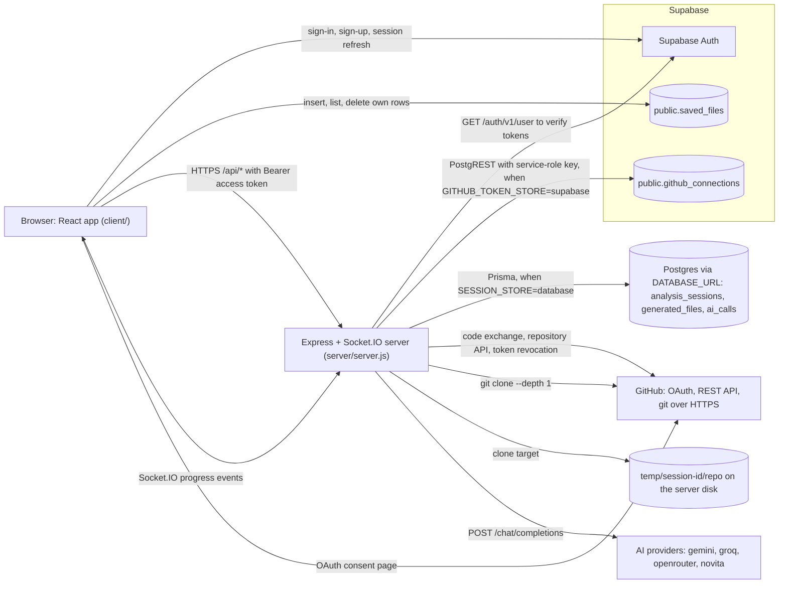
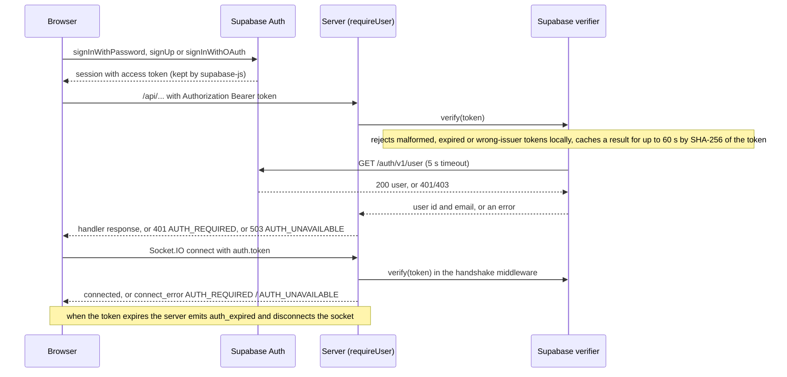
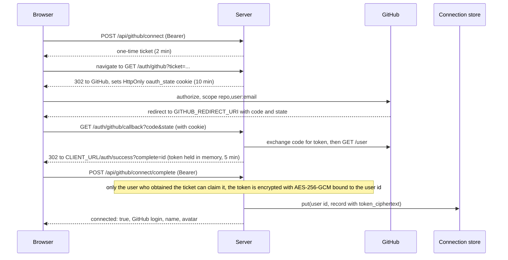
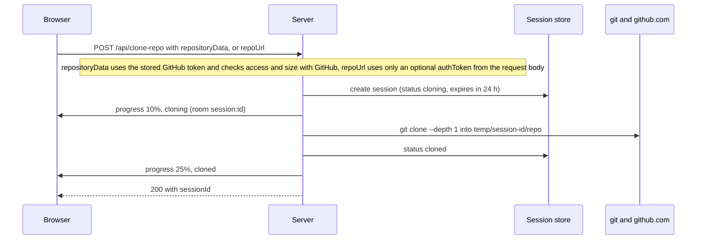
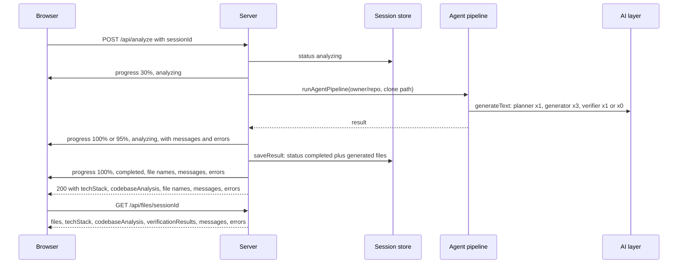
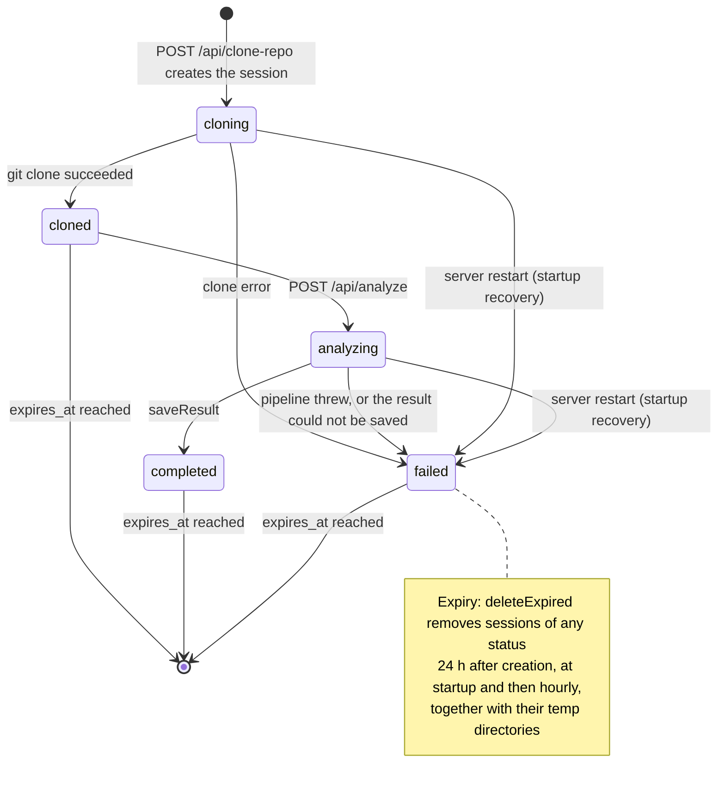
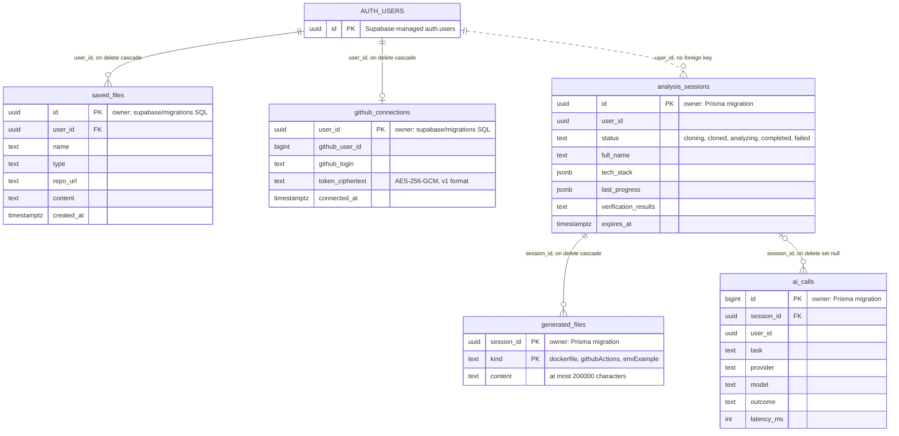

# InfraMind Architecture

InfraMind takes a GitHub repository, clones it on the server, runs four agents in sequence (planner, analyzer, generator, verifier) and produces three files: a Dockerfile, a GitHub Actions workflow and a `.env.example`. This document describes how the parts fit together, as implemented in this repository.

Contents:

1. [System context](#1-system-context)
2. [Sign-in and API authentication](#2-sign-in-and-api-authentication)
3. [GitHub connection](#3-github-connection)
4. [Analysis flow](#4-analysis-flow)
5. [Session lifecycle](#5-session-lifecycle)
6. [Data model](#6-data-model)
7. [AI layer](#7-ai-layer)
8. [Startup checks and configuration](#8-startup-checks-and-configuration)
9. [Code that is not part of the running system](#9-code-that-is-not-part-of-the-running-system)

The agent pipeline and the AI provider fallback have their own diagrams in [README-AI-AGENTS.md](README-AI-AGENTS.md). Deployment is in [DEPLOYMENT-GUIDE.md](DEPLOYMENT-GUIDE.md).

## 1. System context

Source: `server/server.js`, `server/utils/auth.js`, `server/utils/githubConnections.js`, `server/utils/sessionStore.js`, `server/db/client.js`, `server/github.js`, `server/utils/git.js`, `server/ai/client.js`, `server/ai/providers.js`, `client/src/lib/supabase.ts`, `client/src/lib/api.ts`, `client/src/lib/apiClient.ts`, `client/src/components/AgentProgress.tsx`.

Who talks to what:

| Component | Talks to | How |
|---|---|---|
| Browser | Supabase Auth | `@supabase/supabase-js`: email/password, Google and GitHub sign-in (`client/src/lib/supabase.ts`) |
| Browser | `public.saved_files` | Directly, with the anon key and the user's session (`SavedFilesAPI` in `client/src/lib/api.ts`) |
| Browser | Server | `apiFetch` adds `Authorization: Bearer <Supabase access token>` (`client/src/lib/apiClient.ts`); Socket.IO sends the same token in `auth.token` (`client/src/components/AgentProgress.tsx`) |
| Server | Supabase Auth | Verifies every access token with `GET /auth/v1/user` (`server/utils/auth.js`) |
| Server | `public.github_connections` | Only when `GITHUB_TOKEN_STORE=supabase`, through PostgREST with `SUPABASE_SERVICE_ROLE_KEY` (`server/utils/githubConnections.js`) |
| Server | Postgres (`DATABASE_URL`) | Only when `SESSION_STORE=database`, through Prisma (`server/db/client.js`, `server/utils/sessionStore.js`) |
| Server | GitHub | OAuth code exchange, user/repository/organization API calls, token revocation (`server/github.js`); `git clone` over HTTPS (`server/utils/git.js`) |
| Server | AI providers | OpenAI-format `POST {baseUrl}/chat/completions` (`server/ai/client.js`) |

CORS (HTTP and Socket.IO) allows `CLIENT_URL`, `http://localhost:5173` and `https://dev-pilot.vercel.app` (`server/server.js`).

## 2. Sign-in and API authentication

User accounts live in Supabase Auth. The browser signs in with Supabase; the server never sees a password. Every `/api/*` route except `/api/metrics` and `/api/analytics` sits behind `requireUser`, which checks the Supabase access token with Supabase itself.

Source: `client/src/lib/supabase.ts`, `client/src/contexts/AuthContext.tsx`, `client/src/lib/apiClient.ts`, `client/src/components/AgentProgress.tsx`, `server/utils/auth.js`, `server/utils/realtime.js`, `server/server.js`.

Details:

- The verifier caches a positive result for at most 60 s (never past the token's `exp`), holds at most 5,000 entries and runs at most 20 Supabase lookups at once; above that it answers `AUTH_UNAVAILABLE` (`server/utils/auth.js`).
- Raw tokens are not cached or logged; the cache key is the token's SHA-256 hash (`server/utils/auth.js`).
- Socket.IO: a socket joins a room `session:<id>` only with `subscribe` for a session its user owns, and at most 20 rooms per socket. A late subscriber receives the last stored progress snapshot (`server/utils/realtime.js`).
- After an OAuth sign-in, Supabase sends the user back to `<app origin>/dashboard` (`redirectTo` in `client/src/lib/supabase.ts`).

## 3. GitHub connection

Repository access uses a separate GitHub OAuth App run by the server, not the Supabase GitHub sign-in. The GitHub token never reaches the browser: the server stores it encrypted, keyed by the Supabase user id.

Source: `server/server.js` (routes `/api/github/connect`, `/auth/github`, `/auth/github/callback`, `/api/github/connect/complete`, `/auth/github/discard`), `server/utils/githubConnections.js`, `server/github.js`, `client/src/contexts/GitHubContext.tsx`, `client/src/pages/GitHubCallback.tsx`, `client/src/pages/AuthSuccess.tsx`.

Details:

- If `GITHUB_REDIRECT_URI` points at the client route `/auth/github/callback`, `GitHubCallback.tsx` forwards the query string to the server's `/auth/github/callback`. `server/.env.example` points it at the server directly.
- The callback stores nothing. It parks the result under a one-time completion id, because the browser that finishes the OAuth flow is not necessarily the account that started it (`server/server.js`).
- Outcomes of `POST /api/github/connect/complete`: 400 `GITHUB_CONNECT_EXPIRED` or `INVALID_REQUEST`, 403 `GITHUB_CONNECT_MISMATCH` (the token is revoked), 503 `GITHUB_STORE_UNAVAILABLE`. A reconnect revokes the previous token (`server/server.js`).
- Signed out on `/auth/success`, the page calls `POST /auth/github/discard`, which always answers 204 and revokes the parked token. Completions that are never claimed are revoked when they expire (`server/server.js`, `client/src/pages/AuthSuccess.tsx`).
- `DELETE /api/github/connection` revokes the token at GitHub (best effort) and deletes the stored record. A token GitHub rejects with 401 is deleted too (`server/server.js`).
- Store adapters (`GITHUB_TOKEN_STORE`, required): `memory` keeps encrypted rows in process memory and loses them on restart; `supabase` uses `public.github_connections` (`server/utils/githubConnections.js`).

## 4. Analysis flow

There are two ways to start: a repository chosen from the user's connected GitHub account (`repositoryData`), or a URL typed by the user (`repoUrl`). The HTTP calls are `POST /api/clone-repo`, then `POST /api/analyze`, then `GET /api/files/:sessionId`.

### 4a. Clone

### 4b. Analyze and download

Source: `server/server.js` (`handleCloneRequest`, `/api/analyze`, `/api/files/:sessionId`), `server/utils/git.js`, `server/utils/repository.js`, `server/utils/sessionStore.js`, `server/utils/realtime.js`, `server/agents/index.js`, `client/src/pages/RepoSelection.tsx`, `client/src/components/AgentGenerationForm.tsx`, `client/src/components/AgentProgress.tsx`.

Details:

- Progress events go only to the Socket.IO room `session:<id>` and the latest one is stored with the session (`server/utils/realtime.js`). The browser learns the session id only from the clone response, so it is not subscribed when the 10% and 25% events are sent; when it subscribes it receives the latest stored snapshot.
- The agents report progress once, after all four have run. That event carries 100% when the verifier's AI call succeeded or the verifier was skipped (no generated file), and 95% when its call failed (`server/agents/index.js`).
- The final `completed` event, the `POST /api/analyze` response and `GET /api/files/:sessionId` all carry the run's `messages` and `errors`, copied through an allow-list (`toAgentMessages`, `toErrorList` in `server/utils/sessionView.js`). The final event is the stored snapshot, so a late subscriber and a reopened session see which agents finished and why files are missing (`server/server.js`).
- `POST /api/analyze` answers only after the pipeline has finished and the result is saved (`server/server.js`).
- An AI failure inside an agent does not fail the session. The agent adds a fixed message to `errors` and the pipeline continues. The three generator calls are independent: a failed call adds one `Generator Agent Error:` entry and the other files are kept. Only when all three fail does the session complete with no generated files, and then the verifier makes no AI call (`server/agents/index.js`).
- A failed clone or analysis sets the session to `failed` and emits a progress event with 0% and status `failed` (`server/server.js`).
- Clone safety: HTTPS only, `--depth 1 --single-branch --no-tags`, `core.symlinks=false`, no shell, no credential prompts. A token is passed to git as an HTTP header through the child process environment, never in the URL or the arguments. Defaults: 120 s timeout (`CLONE_TIMEOUT_MS`) and 200 MB (`MAX_REPO_SIZE_MB`) (`server/utils/git.js`).
- The clone stays on disk after the analysis; it is removed when its session is deleted at expiry, or at startup if it has no session (`server/server.js`).
- The dashboard opens one session with `/dashboard?session=<id>`: it calls `GET /api/status/:sessionId` and, for a completed session, `GET /api/files/:sessionId`, and subscribes to progress while the session is in flight. `/select-repo` lands there after an analysis (`client/src/pages/ModernDashboard.tsx`, `client/src/pages/RepoSelection.tsx`).
- `GET /api/files/:sessionId/:filename` returns one file as a download; `filename` is one of the generated file keys (`dockerfile`, `githubActions`, `envExample`) (`server/server.js`, `server/agents/index.js`).

## 5. Session lifecycle

Source: `server/utils/sessionStore.js` (`STATUSES`, `IN_FLIGHT`, `SESSION_TTL_MS`, `markInFlightFailed`, `deleteExpired`), `server/server.js` (`handleCloneRequest`, `/api/analyze`, `startServer`, `cleanupExpiredSessions`), `server/prisma/migrations/20261103200038_init/migration.sql` (status check constraint).

- At startup, sessions still in `cloning` or `analyzing` are marked `failed` with the message "The server restarted before this analysis finished. Please run it again." A `cloned` session is not touched (`server/server.js`, `server/utils/sessionStore.js`). This recovery only has an effect with `SESSION_STORE=database`: with `memory` the store starts empty after a restart, so every session is already gone and there is nothing to recover.
- `POST /api/analyze` accepts only a session in `cloned` status; others get 400 "Repository not ready for analysis" (`server/server.js`).
- Results can be fetched only while the session is `completed` (`server/server.js`).

### Where sessions live

`SESSION_STORE` is required and has no default (`server/utils/sessionStore.js`):

| Mode | Storage | On restart |
|---|---|---|
| `memory` | Process memory; at most 1,000 AI call records | Every session and result is lost; in production the server logs a warning |
| `database` | Postgres through Prisma: `analysis_sessions`, `generated_files`, `ai_calls` | Completed sessions survive until they expire; in-flight ones are marked `failed` |

## 6. Data model

Source: `server/prisma/schema.prisma`, `server/prisma/migrations/20261103200038_init/migration.sql`, `supabase/migrations/20261103000000_github_connections.sql`, `supabase/migrations/20261104000000_saved_files.sql`, `client/src/lib/api.ts` (`SavedFilesAPI` columns).

Only the main columns are shown. Ownership and access:

| Table | Schema owned by | Read and written by |
|---|---|---|
| `analysis_sessions`, `generated_files`, `ai_calls` | Prisma migration in `server/prisma/migrations/`, applied with `npm run db:deploy` | The server, as table owner. RLS is enabled with no policies, and all privileges are revoked from `anon` and `authenticated` |
| `github_connections` | `supabase/migrations/20261103000000_github_connections.sql` | The server, with the service-role key. RLS is enabled with no policies, and all privileges are revoked from `anon` and `authenticated` |
| `saved_files` | `supabase/migrations/20261104000000_saved_files.sql` (idempotent; see [DEPLOYMENT-GUIDE.md](DEPLOYMENT-GUIDE.md#12-database-setup)) | The browser, with the anon key and the user's session. RLS policies for `authenticated` limit each user to their own rows; `authenticated` has only `select`, `insert` and `delete`, and `anon` has no privileges |

Further facts:

- `analysis_sessions` stores no filesystem path; the clone path is derived from the session id (`server/utils/repository.js`, `server/utils/sessionStore.js`).
- `ai_calls` holds metadata only: task, provider, model, attempt, outcome, HTTP status, latency, token counts, session and user id. There is no column for prompt, response or error text. Rows are deleted after 30 days (`server/prisma/schema.prisma`, `server/utils/sessionStore.js`).
- The server connects as the table owner, which bypasses RLS, so every per-user read filters by `user_id` in the query (`getOwned` in `server/utils/sessionStore.js`).

## 7. AI layer

The planner, generator and verifier ask `server/ai/` for a *task*; the configuration decides which providers serve it, in which order. Supported providers: `gemini`, `groq`, `openrouter`, `novita`, all called in the OpenAI chat-completions format. There are no default model IDs: each provider used in a route needs `<NAME>_API_KEY` and `<NAME>_MODEL` (`server/ai/providers.js`, `server/ai/config.js`).

| Setting | Default | Allowed | Meaning |
|---|---|---|---|
| `AI_PROVIDERS` | none (required) | comma-separated provider names | Default fallback chain |
| `AI_ROUTE_PLANNER`, `AI_ROUTE_GENERATOR`, `AI_ROUTE_VERIFIER` | `AI_PROVIDERS` | same | Per-task chain |
| `AI_TIMEOUT_MS` | 60000 | 1000-300000 | Timeout of one attempt |
| `AI_CALL_BUDGET_MS` | 180000 | 1000-3600000, at least `AI_TIMEOUT_MS` | Total time for one call across all attempts and providers |
| `AI_MAX_ATTEMPTS_PER_PROVIDER` | 2 | 1-5 | Attempts on one provider before falling back |
| `OPENROUTER_DATA_COLLECTION` | `deny` | `deny`, `allow` | Sent to OpenRouter as `provider.data_collection` |

Retries, fallback and the circuit breaker are described with a diagram in [README-AI-AGENTS.md](README-AI-AGENTS.md#ai-provider-fallback).

## 8. Startup checks and configuration

`startServer()` exits with an error, naming variables but never printing values, when any of these is missing or invalid (`server/server.js`):

1. `SUPABASE_URL` (https, or http for localhost only) and `SUPABASE_ANON_KEY` (`server/utils/auth.js`)
2. `GITHUB_TOKEN_STORE` (`memory` or `supabase`), `GITHUB_TOKEN_ENC_KEY` (standard base64 of exactly 32 bytes) and, for `supabase`, `SUPABASE_SERVICE_ROLE_KEY` (`server/utils/githubConnections.js`)
3. The AI configuration: `AI_PROVIDERS`, routes, and a key and model for every provider in a route (`server/ai/config.js`)
4. `SESSION_STORE` (`memory` or `database`); for `database` also `DATABASE_URL`, a reachable database and the Prisma schema (`server/utils/sessionStore.js`, `server/db/config.js`)

Then it marks interrupted sessions failed, deletes expired sessions and orphaned temp directories, schedules the hourly cleanup and listens on `PORT` (default 10000, `server/utils/port.js`) (`server/server.js`).

Database TLS: for a non-local host the server always uses TLS with certificate verification, whatever `sslmode` says. `DATABASE_SSL_CA_FILE` adds a CA; `DATABASE_SSL_INSECURE_SKIP_VERIFY=true` turns verification off and logs a warning. Pool size `DATABASE_POOL_MAX` defaults to 5 (1-20); connect and query timeouts are 5 s (`server/db/config.js`).

The full variable list with comments is in `server/.env.example`.

## 9. Code that is not part of the running system

`npm start` runs `node server.js`. These files are not loaded by it:

| File | What it is | How it runs |
|---|---|---|
| `server/index.js` | The legacy `devPilotAI` generator, which calls Tavily, Mem0 and Keywords AI | Imported only by `server/test.js` (`npm run test:legacy`) |
| `server/minimal.js` | A mock server with a mock `POST /api/devpilot` and unauthenticated GitHub routes | `npm run start:minimal` and `npm run debug` |
| `server/test-render.js` | An HTTP server that answers every request with a fixed JSON message | `npm run test:render` |
| `server/start.js` | Prints environment details, test-imports modules, then imports `server.js` | `npm run start:debug` |

`server.js` registers no `/api/devpilot` route. Tavily, Mem0 and Keywords AI are not part of the analysis pipeline.

On the client, `client/src/lib/agentApi.ts`, `client/src/lib/mockData.ts`, `client/src/pages/EnhancedDashboard.tsx` and several components are not reachable from any route in `client/src/App.tsx`.
