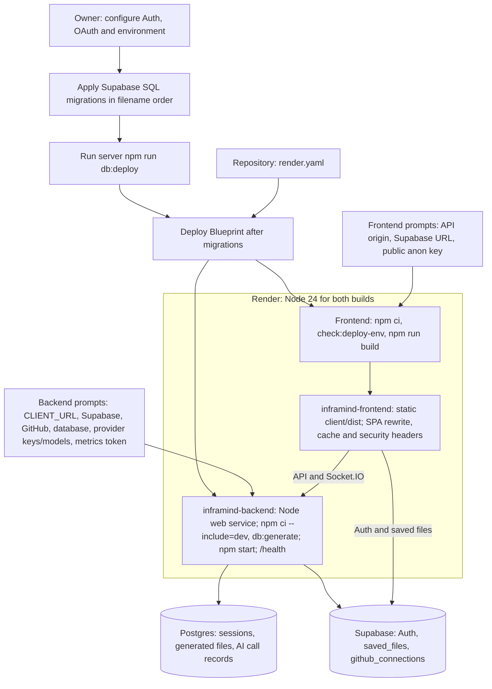

# InfraMind Deployment Guide

How to configure and deploy InfraMind as it is implemented in this repository. For how the parts work together see [ARCHITECTURE.md](ARCHITECTURE.md).

## What you need

- **Node.js 24** for both Render services. Local and CI runs also use Node 22: the client declares `^22.12 || >=24`, and the server declares `^20.19 || ^22.12 || >=24.0`. Use Node 22.18 or later on the 22 line for the client tests, which run TypeScript through Node's default type stripping. The root development launcher requires Node 22 or later
- **`git`** on the server machine: clones run the `git` binary (`server/utils/git.js`)
- **A Supabase project:** Auth, and Postgres for `saved_files` and (optionally) `github_connections`
- **A GitHub OAuth App** for repository access, separate from the GitHub sign-in provider in Supabase
- **At least one AI provider account:** `gemini`, `groq`, `openrouter` or `novita` (`server/ai/providers.js`)
- **Postgres for sessions** if you use `SESSION_STORE=database`. `server/.env.example` describes the Supabase session pooler for this

The server refuses to start without the Supabase, GitHub token store, AI, session store, `CLIENT_URL` and GitHub OAuth App settings, and lists every problem at once; see [Startup checks](#startup-checks).

---

## 1. Supabase

### 1.1 Project and keys

1. Create a project in the [Supabase dashboard](https://supabase.com/dashboard)
2. In **Project Settings → API Keys**, copy:

| Supabase value | Client variable | Server variable |
|---|---|---|
| Project URL | `VITE_SUPABASE_URL` | `SUPABASE_URL` |
| Publishable (anon) key | `VITE_SUPABASE_ANON_KEY` | `SUPABASE_ANON_KEY` |
| Secret (`service_role`) key | never | `SUPABASE_SERVICE_ROLE_KEY`, only with `GITHUB_TOKEN_STORE=supabase` |

The server uses the URL and anon key to verify user access tokens (`server/utils/auth.js`). It uses the service-role key only for `public.github_connections` (`server/utils/githubConnections.js`). The service-role key bypasses Row Level Security: never put it in a `VITE_` variable, because Vite bundles those into browser code.

### 1.2 Database setup

**`public.saved_files`** (used by the browser for "Save to Account" and the Saved Files tab). Apply `supabase/migrations/20261104000000_saved_files.sql`: paste it into the **SQL Editor** and run it, or apply it with the Supabase CLI against your linked project (`supabase db push` applies the files in `supabase/migrations/`).

The migration is idempotent and non-destructive, so it is safe on a project where the table was already created from the SQL this guide used to contain. It uses `create table if not exists` and `create index if not exists`, enables RLS, drops and recreates its three policies by name, and never drops the table, changes columns or touches rows. Before applying it to an existing project, compare the live table and policies with the file: a policy with a different name is not replaced and stays active alongside the new ones.

What it sets up:
- The table `id`, `user_id` (references `auth.users`, cascades on delete), `name`, `type`, `repo_url`, `content`, `created_at`, and the index on `(user_id, created_at desc)`
- Policies for `authenticated` only: a signed-in user can read, insert and delete only rows whose `user_id` matches their own `auth.uid()`. There is no `update` policy, so saved files can't be edited (the app never edits them)
- Privileges: `authenticated` gets exactly `select`, `insert` and `delete`; everything else Supabase grants by default on new tables, including all of `anon`'s access, is revoked. A request without a session (anon key only) is refused

The client uses the columns `id`, `user_id`, `name`, `type`, `repo_url`, `content` and `created_at` (`SavedFilesAPI` in `client/src/lib/api.ts`).

**`public.github_connections`** (needed only with `GITHUB_TOKEN_STORE=supabase`). Apply `supabase/migrations/20261103000000_github_connections.sql`. It creates the table, enables RLS with no policies and revokes all access from `anon` and `authenticated`, so only the service-role key can use it.

Apply Supabase migrations in filename order: `20261103000000_github_connections.sql`, `20261104000000_saved_files.sql`, then `20261106000000_saved_files_limits.sql`. Before the limits migration, run and record the [read-only duplicate count](PRODUCTION-CHECKLIST.md#supabase). The limits migration removes only later copies of a file with the same user, name, repository URL (including null) and content digest, keeping the earliest `(created_at, id)`.

The limits migration requires PostgreSQL 15 or later. It defaults `user_id` to `auth.uid()`, limits new or changed rows to a 1–255-character name, one of `dockerfile`, `github-actions` or `env`, an optional repository URL of at most 2,048 characters, and at most 100,000 content bytes. New inserts are refused when a user already has 500 files; existing rows are not pruned to reach that limit. Existing rows that violate a new shape check stay stored because those checks are added `NOT VALID`; exact duplicate copies are the only rows removed. The three RLS policies and the authenticated role's `select`, `insert`, `delete` privileges remain the same. The plain `content_sha256` column is backfilled with the UTF8 SHA-256 digest; the insert trigger always recomputes it, including when a client supplies a hash. It is not a generated column because PostgreSQL marks `convert_to` stable. Save uses conflict-ignore inserts, so saving the same files again adds nothing; Saved Files loads pages of 50.

After applying it, perform the real-project Save-twice, two-user RLS and Load more checks in [PRODUCTION-CHECKLIST.md](PRODUCTION-CHECKLIST.md#supabase). These are owner steps; local tests use a throwaway PostgreSQL 17 container.

The session tables (`analysis_sessions`, `generated_files`, `ai_calls`) are created by Prisma, not by Supabase SQL; see [section 4](#4-session-database-session_storedatabase).

### 1.3 URL configuration (redirects)

After an OAuth sign-in, the app asks Supabase to send the user back to `<current origin>/dashboard` (see `client/src/lib/supabase.ts`). Supabase only redirects to URLs on its allow list. For any other URL it falls back to the Site URL. A failed or cancelled Google or GitHub sign-in also comes back to `/dashboard`, and the app shows its error on `/auth`; `redirectTo` is still `/dashboard`, so no Supabase setting changes.

In **Authentication → URL Configuration**:

| Setting | Local development | Production |
|---------|-------------------|------------|
| Site URL | `http://localhost:5173` | your frontend URL |
| Redirect URLs | `http://localhost:5173/**` | `<your frontend URL>/**` |

- Site URL holds a single value. Switch it to the production URL when you deploy
- Redirect URLs can hold several. Keep the localhost entry if you also develop against this project, and add any preview-deployment domains you use

### 1.4 Google sign-in

1. In [Google Cloud Console](https://console.cloud.google.com) → **APIs & Services → Credentials**, create an **OAuth client ID** of type **Web application** (set up the OAuth consent screen first if prompted)
2. Under **Authorized redirect URIs**, add `https://<project-ref>.supabase.co/auth/v1/callback`. Supabase shows this exact URL on its Google provider page
3. In Supabase → **Authentication → Sign In / Providers → Google**, enable the provider and paste the Client ID and Client Secret

The callback URL points at Supabase, not at your frontend, so it's the same for local development and production.

### 1.5 GitHub sign-in

1. GitHub → **Settings → Developer settings → OAuth Apps → New OAuth App**
   - Homepage URL: your frontend URL
   - Authorization callback URL: `https://<project-ref>.supabase.co/auth/v1/callback`
2. In Supabase → **Authentication → Sign In / Providers → GitHub**, enable the provider and paste the Client ID and Client Secret

This app is only for signing in to InfraMind. It gives the server no repository access; that is the separate app in [section 2](#2-github-oauth-app-for-repository-access).

### 1.6 Email and password

The Email provider is enabled by default. With **Confirm email** on (the default), new users must click the confirmation link before they can sign in. In that case the app shows "Check your email to confirm your account, then sign in." (`client/src/lib/supabase.ts`). You can turn confirmation off for local testing. Supabase's built-in email sender is rate-limited, so configure custom SMTP under **Authentication → Emails** before production.

---

## 2. GitHub OAuth App for repository access

This app is run by the InfraMind server (`server/github.js`). It requests the scope `repo,user:email`.

1. GitHub → **Settings → Developer settings → OAuth Apps → New OAuth App**
2. Authorization callback URL: the server's `/auth/github/callback`, for example `http://localhost:10000/auth/github/callback` locally (as in `server/.env.example`) or `https://<your-backend>/auth/github/callback` in production
3. Set on the server:

```bash
GITHUB_CLIENT_ID=...
GITHUB_CLIENT_SECRET=...
GITHUB_REDIRECT_URI=<the callback URL from step 2>
CLIENT_URL=<your frontend URL>     # the server redirects to CLIENT_URL/auth/success after the callback
GITHUB_TOKEN_STORE=supabase        # or memory (connections are lost on restart)
GITHUB_TOKEN_ENC_KEY=<openssl rand -base64 32>
```

`GITHUB_REDIRECT_URI` may instead point at the client's `/auth/github/callback` route, which forwards the query string to the server (`client/src/pages/GitHubCallback.tsx`). The step-by-step connect flow is diagram 3 in [ARCHITECTURE.md](ARCHITECTURE.md#3-github-connection).

`GITHUB_TOKEN_ENC_KEY` encrypts every stored token. Changing it makes existing connections unreadable: the server deletes an unreadable connection on its next read, and the user has to connect again (`server/utils/githubConnections.js`).

---

## 3. AI providers

```bash
AI_PROVIDERS=gemini,groq,openrouter      # default chain, in order
# Optional per-task chains:
# AI_ROUTE_GENERATOR=gemini,openrouter
# AI_ROUTE_VERIFIER=groq,gemini
GEMINI_API_KEY=...
GEMINI_MODEL=<model id>
# ...the same pair for every other provider in any chain
```

- Every provider in any chain needs `<NAME>_API_KEY` and `<NAME>_MODEL`. There are no default model IDs (`server/ai/providers.js`, `server/ai/config.js`).
- `AI_ROUTE_PLANNER` is no longer used (the planner agent was removed). If it is still set, for example in an existing Render environment, the server starts and logs one warning naming it; it can be removed.
- Up to 300 of the repository's file paths, the detected tech stack, and the contents of its top-level manifests (such as `requirements.txt`, `pyproject.toml`, `package.json`; up to 8 KB each, 32 KB in total) and of the first two existing Dockerfiles found at any depth and the workflows (up to 4 KB each) are sent to these providers. `.env` files are never read ([README-AI-AGENTS.md](README-AI-AGENTS.md#what-reaches-the-ai-providers)).
- Credentials found in manifests and in the existing Dockerfile and workflow excerpts are redacted on a best-effort basis before they reach a prompt: URL user names and passwords, tokens shaped like known secrets, the values of keys containing TOKEN, SECRET, PASSWORD, PASSWD, API_KEY or PRIVATE_KEY (also in quoted headers and Dockerfile `ENV`/`ARG KEY value`), `Authorization:` and `Proxy-Authorization:` credentials, Slack and Discord webhook paths, `curl -u`/`--oauth2-bearer` values and `docker login -p`/`--password` values (also in a command continued over several lines with `\`) become `REDACTED` (`redactCredentials` in `server/agents/grounding.js`); keep secrets out of manifests.
- Limits: `AI_TIMEOUT_MS` (default 60000), `AI_CALL_BUDGET_MS` (default 180000), `AI_MAX_ATTEMPTS_PER_PROVIDER` (default 2) (`server/ai/config.js`).
- Check the configuration against the real providers with `RUN_LIVE_AI=1 npm run ai:smoke` in `server/` (`server/scripts/ai-smoke.js`).

---

## 4. Session database (`SESSION_STORE=database`)

With `SESSION_STORE=memory` every session and result is lost on restart. For production use `database`, which keeps sessions in Postgres through Prisma (`server/utils/sessionStore.js`).

1. Set `DATABASE_URL`. `server/.env.example` describes the Supabase **Session pooler** string (port 5432)
2. Generate the Prisma client: `npm run db:generate` in `server/` (writes `server/generated/prisma`)
3. Apply the migration **manually**: `npm run db:deploy` in `server/` (`prisma migrate deploy`). `npm run db:status` shows what is applied
4. Start the server with `SESSION_STORE=database`

At startup the server checks that the database answers and that the schema exists. Otherwise it exits with "Database unreachable (DATABASE_URL)" or "Database schema missing: run npm run db:deploy" (`server/server.js`).

Never run `npm run db:migrate:dev` against Supabase. It runs `server/scripts/assert-local-db.js` first, which refuses any `DATABASE_URL` host other than `localhost`, `127.0.0.1` or `::1`.

TLS: for any non-local host the server always uses TLS and verifies the certificate. If verification fails, point `DATABASE_SSL_CA_FILE` at the CA certificate; `DATABASE_SSL_INSECURE_SKIP_VERIFY=true` turns verification off and logs a warning at startup (`server/db/config.js`).

---

## 5. Local development

```bash
npm run install:all                       # root, client and server dependencies
cp server/.env.example server/.env        # then fill it in
cp client/.env.example client/.env.local  # then fill it in
npm run dev                               # client and server together (concurrently)
```

| Setting | Where it comes from |
|---|---|
| Client dev server | `http://localhost:5173` (`client/vite.config.ts`) |
| Server port | `PORT`; without it 10000 (`server/utils/port.js`), the same value as `server/.env.example` and `render.yaml` |
| Client → server URL | `VITE_API_URL`; without it the client uses `http://localhost:10000` (`client/src/lib/api.ts`) |
| CORS and Socket.IO origins | `CLIENT_URL`'s origin, `CORS_ALLOWED_ORIGINS`, and `http://localhost:5173` when `NODE_ENV` is not `production` (`server/utils/config.js`) |

Set `VITE_API_URL` to the server's actual URL whenever the port is not 10000. The client reads `VITE_*` variables at build time (Vite), so restart the dev server or rebuild after changing them.

---

## Deployment on Render

`render.yaml` defines `inframind-backend` as a Node web service (`runtime: node`) and `inframind-frontend` as a static site (`runtime: static`). Both builds use Node 24. The owner applies the Supabase SQL migrations in filename order, runs `npm run db:deploy` in `server/`, and then deploys the Blueprint. The backend build generates the Prisma client but never applies migrations.

At the first Blueprint deploy, Render asks for each `sync: false` setting below. The supplied values stay in the service dashboard afterwards; update them there for later deployments. The frontend's `VITE_*` values are inlined during its build, so changing them requires a rebuild.

| Service | Fixed in the Blueprint | Prompted at the first deploy |
|---|---|---|
| Backend | `NODE_VERSION=24`, `NODE_ENV=production`, `PORT=10000`, `SESSION_STORE=database`, `GITHUB_TOKEN_STORE=supabase`, `OPENROUTER_DATA_COLLECTION=deny` | `CLIENT_URL`; `SUPABASE_URL`, `SUPABASE_ANON_KEY`, `SUPABASE_SERVICE_ROLE_KEY`; `GITHUB_TOKEN_ENC_KEY`, `GITHUB_CLIENT_ID`, `GITHUB_CLIENT_SECRET`, `GITHUB_REDIRECT_URI`; `DATABASE_URL`; `AI_PROVIDERS`; `GEMINI_API_KEY`, `GEMINI_MODEL`, `GROQ_API_KEY`, `GROQ_MODEL`, `OPENROUTER_API_KEY`, `OPENROUTER_MODEL`; `METRICS_TOKEN` |
| Frontend | `NODE_VERSION=24` | `VITE_API_URL`, `VITE_SUPABASE_URL`, `VITE_SUPABASE_ANON_KEY` |

The Blueprint prompts for all three supported deployment providers' key/model pairs. Startup requires the pairs for providers actually used by the generator or verifier routes; model IDs have no default. `METRICS_TOKEN` is optional in the server code, but the Blueprint asks for a 32-character-or-longer token so the owner can use the protected operator endpoints.



The backend command is `cd server && npm ci --include=dev && npm run db:generate`; the dev dependencies include the Prisma CLI. Its start command is `cd server && npm start`. The frontend command is `cd client && npm ci && npm run check:deploy-env && npm run build`, publishing `client/dist`. The owner's exact environment sources and post-deploy checks are in [the Render checklist](PRODUCTION-CHECKLIST.md#render-deployment-owner-t-161).

### Frontend deployment guard

`npm run check:deploy-env` reads only `process.env`; it never loads a `.env` file. Render runs it before the production build. It is separate from `npm run build`, so local and offline CI builds keep their existing behavior.

| Failure named by the guard | What to change in the frontend service |
|---|---|
| `NODE_ENV` is set to anything except `production` | Unset it or set `production`; `development` enables the error boundary's development details |
| Any required `VITE_*` value is missing or empty | Set `VITE_API_URL`, `VITE_SUPABASE_URL` and `VITE_SUPABASE_ANON_KEY` in the service environment |
| A URL is invalid, uses HTTP, or names `localhost`, `127.0.0.1`, `[::1]`, `0.0.0.0` or `*.local` | Use the public HTTPS backend origin and Supabase project URL |
| `VITE_API_URL` includes a path, query, fragment or trailing slash | Use only `https://<backend host>` because the app appends its endpoint paths |
| The key is a JWT with `role=service_role` or starts with `sb_secret_` | Replace it with the project's public anon/publishable key; browser bundles must not contain a server secret |

The guard names a failing variable without printing its value. On success it prints each variable name and, for URLs, only the host. It never prints the anon key.

### Static routes, caching and security headers

The `/*` to `/index.html` rewrite serves application deep links such as `/dashboard?session=<id>`. Render checks for an existing resource before applying rewrites, and applies the first matching redirect/rewrite rule in list order. See [Render's rule matching and ordering](https://render.com/docs/redirects-rewrites#rule-matching-and-ordering). Existing `/assets/<hash>.js` files are therefore served normally. A missing `/assets/*` file still matches the SPA rewrite and returns `index.html` with HTTP 200.

| Path | Header | Value |
|---|---|---|
| `/*` | `X-Content-Type-Options` | `nosniff` |
| `/*` | `X-Frame-Options` | `DENY` |
| `/*` | `Referrer-Policy` | `strict-origin-when-cross-origin` |
| `/*` | `Permissions-Policy` | `camera=(), microphone=(), geolocation=()` |
| `/assets/*` | `Cache-Control` | `public, max-age=31536000, immutable` |
| `/index.html` and `/` | `Cache-Control` | `no-cache` |

Asset names are content-hashed, so the long asset cache can coexist with an HTML document that must be revalidated. Content-Security-Policy is deferred to T-605: its allowed API, Supabase, avatar and font origins need the real deployment hosts.

### Optional backend settings

These settings stay out of `render.yaml`; add an override in the backend dashboard only when needed. `server/.env.example` documents their defaults and validation.

| Setting | Default and use |
|---|---|
| `TRUST_PROXY` | `0`; integer 0–3, chosen only after [checking the client IP](#checking-the-client-ip) |
| `CORS_ALLOWED_ORIGINS` | No extra origins; comma-separated exact HTTP(S) origins. `CLIENT_URL` is always allowed; localhost:5173 is added automatically only outside production |
| `ANALYSIS_CONCURRENCY`, `ANALYSIS_QUEUE_MAX` | `2` running and `20` queued per process; ranges 1–8 and 0–100 |
| `RATE_LIMIT_<NAME>_MAX` | Existing fixed-window defaults from `server/utils/config.js`; counts 1–100000, limiting stays enabled |
| `GITHUB_TIMEOUT_MS` | `10000` ms; range 1000–60000 |
| `GITHUB_CONNECT_COMPLETION_TTL_MS` | `300000` ms; range 1000–300000 for pending connection completion IDs; invalid values warn and fall back |
| `CLONE_TIMEOUT_MS`, `MAX_REPO_SIZE_MB` | `120000` ms and `200` MB; positive integer overrides, invalid values fall back |
| `AI_TIMEOUT_MS`, `AI_CALL_BUDGET_MS`, `AI_MAX_ATTEMPTS_PER_PROVIDER` | `60000` ms, `180000` ms and `2`; the total call budget must be at least the per-attempt timeout |
| `AI_ROUTE_GENERATOR`, `AI_ROUTE_VERIFIER` | Use `AI_PROVIDERS` unless overridden with a provider chain |
| `<NAME>_BASE_URL`, `<NAME>_JSON_MODE` | Provider registry URL and `json_object`; optional proxy endpoint or JSON-mode override |
| `DATABASE_POOL_MAX` | `5` connections per process; range 1–20 |
| `DATABASE_SSL_CA_FILE`, `DATABASE_SSL_INSECURE_SKIP_VERIFY` | System trust and `false`; supply a CA file for verified TLS when needed. Skipping verification logs a warning |

Remove `AI_ROUTE_PLANNER` from an existing environment: the planner was removed and its setting only causes a warning. Other provider support in the registry, such as Novita, remains optional; configure its key/model if a route uses it.

### Checking the client IP

With `TRUST_PROXY` unset, make requests from two devices or networks and compare the `ip` in the backend access-log lines (`server/utils/security.js`). If both show a Render-internal address, try `TRUST_PROXY=1`, redeploy and compare again with the devices' public addresses. If necessary, try 2, then 3; choose the smallest value that reports the actual clients. Never trust more proxies than the real hop count, and never set boolean `true`: client-supplied entries farther left in `X-Forwarded-For` can be forged.

`/health` is a liveness check: HTTP 200 with `{ status: "ok", timestamp, uptime }` does not check the database, Supabase or AI providers. Startup validates the environment and, in database mode, checks database connectivity and schema. Run one backend instance: the analysis queue is in process memory. A restart or deploy ends running and queued analyses; with `SESSION_STORE=database`, the next start marks them failed with the restart message and the user starts again.

### Other frontend hosts

The static build is `client/dist`. A different static host needs the same three public build settings, the deployment guard, a deep-link fallback that serves existing assets first, and equivalent cache/security headers. The backend allows `CLIENT_URL` and any explicitly configured `CORS_ALLOWED_ORIGINS` for CORS and Socket.IO.

---

## Startup checks

`startServer()` in `server/server.js` first collects every configuration problem and prints them as one list, `Configuration problems (N):` followed by one `❌` line each, then exits 1. Only when the list is empty does it check the database connection, then the schema. Messages name variables, never values.

| Message (start) | Fix |
|---|---|
| `SUPABASE_URL ...` / `SUPABASE_ANON_KEY is not set` | Set both (https URL; http only for localhost) |
| `GITHUB_TOKEN_STORE is not set` / `must be "memory" or "supabase"` | Set `GITHUB_TOKEN_STORE` |
| `GITHUB_TOKEN_ENC_KEY ...` | `openssl rand -base64 32` |
| `SUPABASE_SERVICE_ROLE_KEY is not set (required when GITHUB_TOKEN_STORE=supabase)` | Set it, or use `memory` |
| `AI_PROVIDERS is not set ...`, `<NAME>_API_KEY is not set ...`, `<NAME>_MODEL is not set ...` | Fix the AI settings |
| `SESSION_STORE is not set (use "memory" or "database")` | Set `SESSION_STORE` |
| `DATABASE_URL ...` | Set a `postgres://` or `postgresql://` URL |
| `PORT must be an integer from 1 to 65535` | Fix or unset `PORT` |
| `CLIENT_URL is not set` / `must use https when NODE_ENV=production` / `must be an origin only` | Set the frontend origin, for example `https://app.example.com` |
| `GITHUB_CLIENT_ID is not set` / `is still the placeholder from .env.example` (same for `GITHUB_CLIENT_SECRET`) | Copy both from the OAuth App |
| `GITHUB_REDIRECT_URI ...` | An absolute URL ending in `/auth/github/callback`, https in production |
| `TRUST_PROXY must be an integer from 0 to 3` | Set the number of proxies, or unset it |
| `CORS_ALLOWED_ORIGINS entry N ...` | Each entry exactly `scheme://host[:port]`, http or https |
| `RATE_LIMIT_<NAME>_MAX must be an integer from 1 to 100000` / `is not a known rate limit` | Fix the value or the variable name |
| `GITHUB_TIMEOUT_MS must be an integer from 1000 to 60000` | Fix or unset it |
| `METRICS_TOKEN must be at least 32 characters` | Use 32+ random characters, or leave it empty |
| `ANALYSIS_CONCURRENCY must be an integer from 1 to 8` / `ANALYSIS_QUEUE_MAX must be an integer from 0 to 100` | Fix or unset it |
| `Prisma client not generated: run npm run db:generate` | Run it in `server/` |
| `Database unreachable (DATABASE_URL)` | Check the URL, network and TLS settings |
| `Database schema missing: run npm run db:deploy` | Apply the migration |

## Troubleshooting

| Symptom | Where to look |
|---|---|
| Every API call returns 401 `AUTH_REQUIRED` | The client is not sending a Supabase session token, or the server's `SUPABASE_URL` / `SUPABASE_ANON_KEY` belong to another project (`server/utils/auth.js`) |
| API calls return 503 `AUTH_UNAVAILABLE` | The server cannot reach Supabase Auth (`server/utils/auth.js`) |
| "Connect GitHub" ends on `/auth/success` with an error | `invalid_state` (cookie missing or expired), `connect_expired` (ticket older than 2 minutes), `access_denied`, or `github_auth_failed`; check `GITHUB_CLIENT_ID`, `GITHUB_CLIENT_SECRET`, `GITHUB_REDIRECT_URI` and `CLIENT_URL` (`server/server.js`) |
| 503 `GITHUB_STORE_UNAVAILABLE` | The `github_connections` table or the service-role key is not reachable (`server/utils/githubConnections.js`) |
| 503 `SESSION_STORE_UNAVAILABLE` | The session database is not reachable (`server/server.js`) |
| 429 `RATE_LIMITED` for many users at once | Behind Render without `TRUST_PROXY`, every visitor shares one IP bucket; see [Checking the client IP](#checking-the-client-ip) |
| 503 `GITHUB_RATE_LIMITED` | GitHub rate-limited this user's token; `Retry-After` says when to retry (`server/github.js`) |
| 504 `GITHUB_UNAVAILABLE` | GitHub did not answer within `GITHUB_TIMEOUT_MS` (default 10 s) or could not be reached |
| 503 `ANALYSIS_BUSY` on "Start AI Analysis" | `ANALYSIS_CONCURRENCY` analyses are running and `ANALYSIS_QUEUE_MAX` are waiting; `analysisJobs` in `/api/metrics` shows the counts. The cloned session can be retried (`server/server.js`) |
| An analysis shows `failed` with "The server restarted before this analysis finished" | The backend restarted or redeployed while it ran or waited (`markInFlightFailed`) |
| The browser gets no CORS headers, or the socket does not connect | The page's origin is not `CLIENT_URL`'s origin or in `CORS_ALLOWED_ORIGINS`; the startup line `🌐 Allowed origins:` shows the list |
| Clone fails with 404 "Repository not found or access denied" | The repository is private and was entered as a URL without a token, or the GitHub connection cannot see it (`server/utils/git.js`, `server/server.js`) |
| Saved files list is empty or an insert fails | The `saved_files` table or its policies are missing, or the user has no session |
| `errors` shows "AI providers are unavailable" | See the `ai_call` log lines ([server/OBSERVABILITY.md](server/OBSERVABILITY.md)) |
