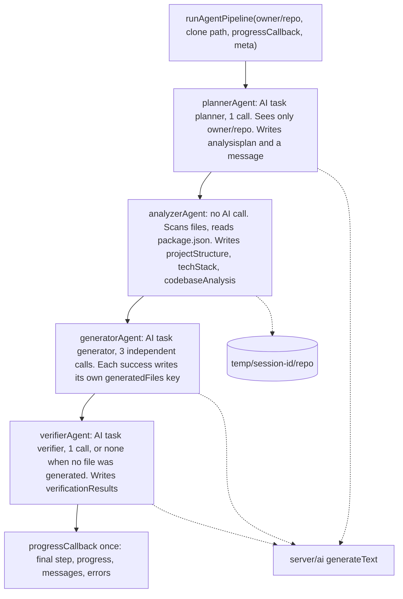
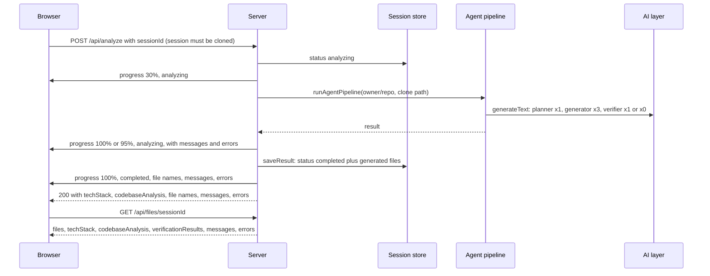
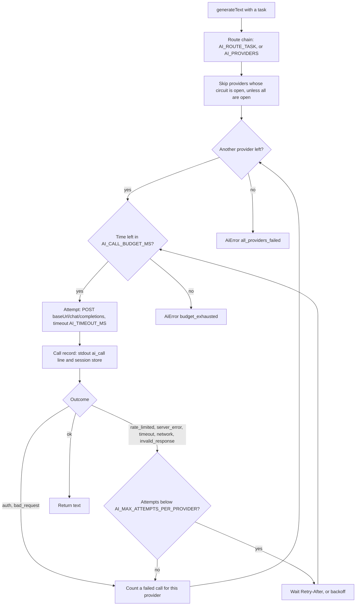

# InfraMind Agents and AI Layer

This document describes the four-agent pipeline in `server/agents/index.js` and the AI provider layer in `server/ai/`, as implemented. For the whole system see [ARCHITECTURE.md](ARCHITECTURE.md).

## What the pipeline produces

For one cloned repository, the pipeline returns:

- `generatedFiles.dockerfile`, `generatedFiles.githubActions`, `generatedFiles.envExample`: text produced by the AI layer (one call each)
- `techStack` and `codebaseAnalysis`: computed from the cloned files, without AI
- `verificationResults`: the verifier's review text
- `messages` (one per agent that finished) and `errors`

The server stores these with the session (`saveResult` in `server/utils/sessionStore.js`) and serves them from `GET /api/files/:sessionId`.

## Agent pipeline



Source: `server/agents/index.js` (`plannerAgent`, `analyzerAgent`, `generatorAgent`, `verifierAgent`, `scanProjectStructure`, `analyzeTechStack`, `performDetailedAnalysis`, `createAgentWorkflow`, `runAgentPipeline`).

How each agent works:

| Agent | `state.progress` | AI task | Input it uses | Writes to state |
|---|---|---|---|---|
| Planner | 20 | `planner`, 1 call | The `owner/repo` name only | `analysisplan`, one message |
| Analyzer | 50 | none | The cloned files: a file list (skipping `.git`, `node_modules`, `.next`, `dist`, `build`, `__pycache__` and symlinks) and `package.json` | `projectStructure`, `techStack`, `codebaseAnalysis`, one message |
| Generator | 80 | `generator`, 3 independent calls | `techStack`, `projectStructure`, `codebaseAnalysis` | One `generatedFiles` key per successful call (`dockerfile`, `githubActions`, `envExample`); one message "Generated N of 3 files" when N > 0 |
| Verifier | 95; 100 when its call succeeds or it is skipped; stays 95 when its call fails | `verifier`, 1 call, or none when no file was generated | The first 500 characters of each generated file | `verificationResults` and one message, only when its call succeeds |

Facts worth knowing:

- The agents run strictly in sequence, in a fixed order, sharing one `AgentState` object. No orchestration library is used (`createAgentWorkflow`).
- The planner's output (`analysisplan`) is not passed to any later agent and is not saved with the session (`server/agents/index.js`, `saveResult` in `server/utils/sessionStore.js`).
- The individual agents do not emit progress. `runAgentPipeline` calls `progressCallback` once, after the verifier (`server/agents/index.js`).
- Each agent catches its own errors. An AI failure adds `"<Agent> Agent Error: AI providers are unavailable"` to `errors`; any other error adds `"<Agent> Agent Error: Internal error"` and is logged server-side with secrets redacted. The next agent still runs (`publicErrorMessage` in `server/agents/index.js`, `AI_UNAVAILABLE_MESSAGE` in `server/ai/errors.js`).
- The three generator calls are independent, in the order Dockerfile, GitHub Actions workflow, `.env.example`. A failed call adds one entry such as `"Generator Agent Error: Dockerfile: AI providers are unavailable"` and the other files are kept (`generatorAgent`).
- With no generated file, the verifier makes no AI call, adds no message and leaves `verificationResults` unset; its step reads "Review skipped: no files were generated" (`verifierAgent`).
- When its call succeeds, the verifier's message is "Review complete: see the review text"; the review itself is `verificationResults` (`verifierAgent`).
- The analyzer reads repository files only through `readRepoFile`, which refuses paths outside the clone and anything that is not a regular file (`server/agents/index.js`).

What the analyzer detects (`analyzeTechStack`):

- Primary: `node` (`package.json`), `python` (`requirements.txt` or `pyproject.toml`), `go` (`go.mod`), `rust` (`Cargo.toml`), `java` (`pom.xml` or `build.gradle`), otherwise `unknown`
- Frameworks: `react`, `nextjs`, `vue`, `express` from `package.json` dependencies; `django` (`manage.py`); `flask`, `fastapi` and `spring` when a file path contains that word
- Databases: `mongodb` (`mongoose`) and `postgresql` (`pg`) from `package.json` dependencies
- Tools: `docker` (a top-level `Dockerfile`); `docker-compose` (a top-level `docker-compose.yml`, `docker-compose.yaml`, `compose.yml` or `compose.yaml`); `kubernetes` when a directory named `k8s` or `kubernetes` exists at any depth (so any YAML file under one counts), or a file named `kustomization.yaml`, `kustomization.yml` or `Chart.yaml` exists at any depth. Only names are checked; other YAML files do not count. Skipped directories such as `node_modules` are never scanned (`hasKubernetesEvidence`, `COMPOSE_FILES`)

### What reaches the AI providers

- Planner: the repository's `owner/repo` name
- Generator: the detected tech stack, the full file list and the `codebaseAnalysis` object, which includes the `dependencies` map from `package.json`
- Verifier: the first 500 characters of each generated file (no call when there is none)

Source file contents other than `package.json` fields are not sent. Session and user ids go only into the call records, never to a provider (`server/agents/index.js`, `AgentState.meta`).

## Analysis flow

The HTTP and Socket.IO sequence around the pipeline:



Source: `server/server.js` (`/api/analyze`, `/api/files/:sessionId`), `server/agents/index.js`, `server/utils/sessionStore.js`, `server/utils/realtime.js`.

The full sequence, including the clone step (10% and 25%), is diagram 4 in [ARCHITECTURE.md](ARCHITECTURE.md#4-analysis-flow).

Progress events are named `progress` and carry `sessionId` plus any of `step`, `progress`, `status`, `messages`, `errors`, `error`, `techStack`, `generatedFiles` (`toProgressPayload` in `server/utils/sessionView.js`).

The final `completed` event also carries `messages` and `errors`, passed through the same allow-list as `GET /api/files` (`toAgentMessages`, `toErrorList` in `server/utils/sessionView.js`). It is stored as the session's last progress snapshot, so a socket that subscribes after the run receives both.

## AI provider fallback



Source: `server/ai/client.js` (`run`, `callProvider`, `attemptOnce`, `backoffMs`, `retryAfterMs`, circuit functions), `server/ai/config.js`, `server/ai/errors.js`, `server/server.js` (`setDefaultAiCallSink`), `server/utils/sessionStore.js` (`recordAiCall`).

The rules, from `server/ai/client.js` and `server/ai/config.js`:

- **Chain:** `AI_ROUTE_PLANNER`, `AI_ROUTE_GENERATOR` or `AI_ROUTE_VERIFIER` when set, otherwise `AI_PROVIDERS`. Names must be from `gemini`, `groq`, `openrouter`, `novita`, without duplicates.
- **Attempts:** up to `AI_MAX_ATTEMPTS_PER_PROVIDER` (default 2) per provider per call. Each attempt's timeout is `AI_TIMEOUT_MS` (default 60000), shortened to what is left of the call budget.
- **Retried on the same provider:** `rate_limited` (429), `server_error` (5xx), `timeout`, `network`, `invalid_response`. The wait is the `Retry-After` header for 429 and 503 (whole seconds, capped at 10 s), otherwise exponential backoff from 500 ms, capped at 8 s, with ±20% jitter.
- **Not retried on the same provider:** `auth` (401, 403) and `bad_request` (other 4xx). The call moves to the next provider.
- **Budget:** one call may take at most `AI_CALL_BUDGET_MS` (default 180000) across all attempts and providers. If a wait would pass the deadline, the call stops with `budget_exhausted`.
- **Circuit breaker:** after 3 failed calls in a row a provider is skipped for 60 s; an `auth` failure skips it for 5 minutes at once. If every provider in the chain is skipped, all of them are tried anyway.
- **Errors:** `AiError` always has the message "AI providers are unavailable" and a list of attempts holding provider, model, outcome and HTTP status only.
- **Call records:** one per attempt, with task, provider, model, attempt, outcome, HTTP status, latency, token counts, session id and user id. The server prints each as an `ai_call ...` line (without the user id) and stores it through the session store: the `ai_calls` table with `SESSION_STORE=database`, process memory with `memory`. A failing record write never affects the call (`server/server.js`, `server/ai/client.js`).
- **Structured output:** `generateObject` (zod schema, `<NAME>_JSON_MODE` of `json_object`, `json_schema` or `prompt`, one repair attempt on `schema_invalid`) exists in the AI layer, but the agents use only `generateText`. `npm run ai:smoke` calls both (`server/scripts/ai-smoke.js`).
- **OpenRouter:** requests carry `provider.data_collection` from `OPENROUTER_DATA_COLLECTION` (default `deny`) and an `X-Title: InfraMind` header, plus `HTTP-Referer` when `CLIENT_URL` is set (`server/ai/providers.js`).

At startup the server prints one line per task with provider names and models, never keys or URLs (`describeAiRoutes`).

## Configuration

Minimum for the AI layer, in `server/.env` (see `server/.env.example` for every variable):

```bash
AI_PROVIDERS=gemini,groq          # default chain; any of gemini, groq, openrouter, novita
GEMINI_API_KEY=...
GEMINI_MODEL=<a current Gemini model id>
GROQ_API_KEY=...
GROQ_MODEL=<a current Groq model id>
```

The server refuses to start when a provider in any route lacks its key or model (`loadAiConfig` in `server/ai/config.js`). Optional per provider: `<NAME>_BASE_URL` (https, or http for localhost) and `<NAME>_JSON_MODE`.

To check a configuration against the real providers: `RUN_LIVE_AI=1 npm run ai:smoke` in `server/` (`server/scripts/ai-smoke.js`).

## Adding an agent

`createAgentWorkflow()` takes no options. Write an `async (state) => state` function in `server/agents/index.js` and add it to the sequence in `invoke`:

```javascript
state = await plannerAgent(state);
state = await analyzerAgent(state);
state = await generatorAgent(state);
state = await verifierAgent(state);
// state = await yourNewAgent(state);
```

A new agent that calls the AI layer must use one of the tasks in `TASKS` (`planner`, `generator`, `verifier`) or add a task there and in `ROUTE_VARS` (`server/ai/config.js`).

## Tests

`npm test` in `server/` runs the `node --test` suite in `server/test/` (`server/package.json`). It uses local fakes for GitHub, Supabase and the AI providers (`server/test/fakeGitHub.js`, `fakeSupabase.js`, `fakeLlm.js`).

## Troubleshooting

| Symptom | Cause in the code |
|---|---|
| The server exits at startup listing `AI_PROVIDERS` or a `<NAME>_API_KEY` / `<NAME>_MODEL` problem | `loadAiConfig` rejected the configuration (`server/ai/config.js`) |
| `errors` contains "AI providers are unavailable" | Every provider in that task's chain failed, or the call budget ran out; the `ai_call` lines show each attempt's outcome |
| The session completed but has no files | All three generator calls failed; `errors` has one `Generator Agent Error:` entry per file (`generatorAgent`) |
| No progress events in the browser | The socket was refused (`AUTH_REQUIRED` / `AUTH_UNAVAILABLE`), or it is not subscribed to the session; check `VITE_API_URL` points at the server |
