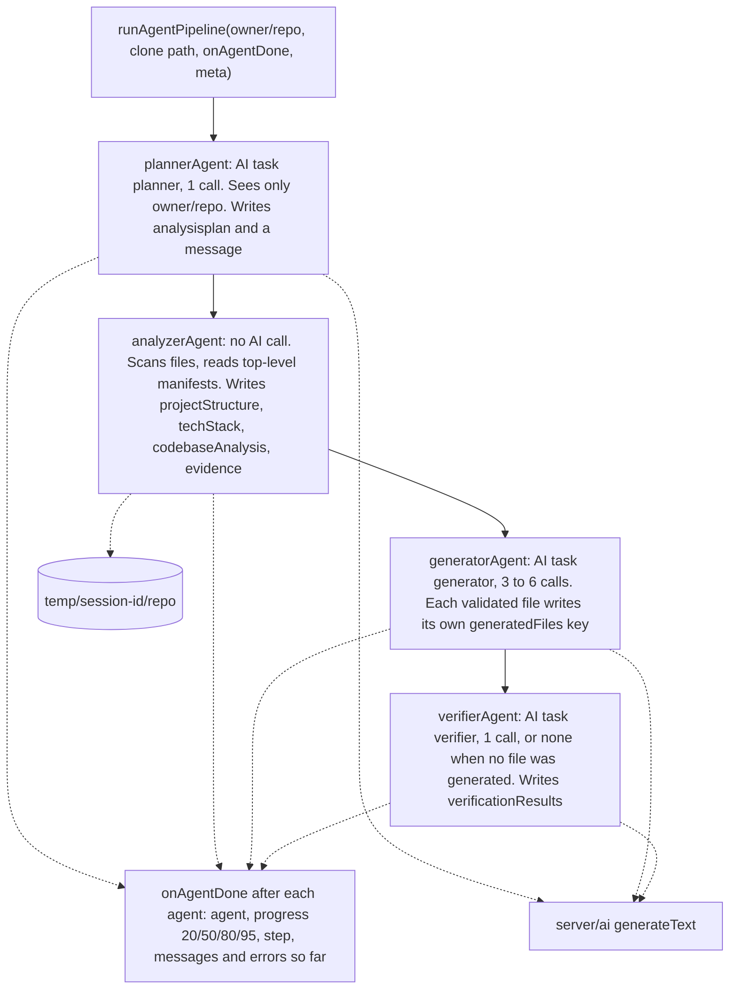
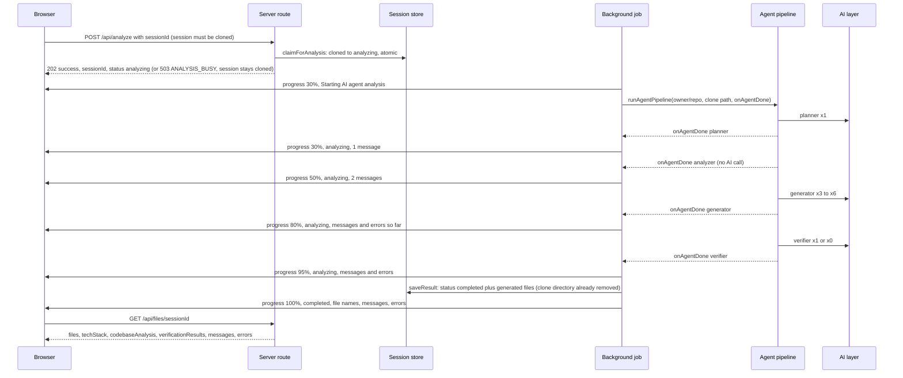
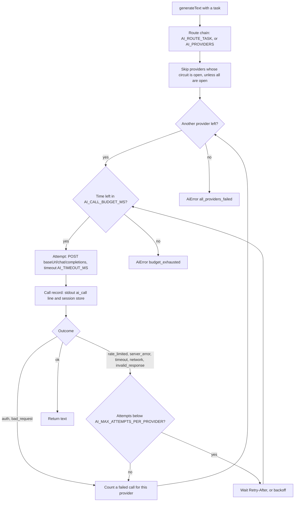

# InfraMind Agents and AI Layer

This document describes the four-agent pipeline in `server/agents/index.js` and the AI provider layer in `server/ai/`, as implemented. For the whole system see [ARCHITECTURE.md](ARCHITECTURE.md).

## What the pipeline produces

For one cloned repository, the pipeline returns:

- `generatedFiles.dockerfile`, `generatedFiles.githubActions`, `generatedFiles.envExample`: one raw file each, extracted from the AI reply and validated before it is kept (one call each, plus one repair call when the first reply fails validation). A file that fails validation twice is left out
- `techStack` and `codebaseAnalysis`: computed from the cloned files, without AI
- `verificationResults`: the verifier's review text
- `messages` (one per agent that finished) and `errors`

The server stores these with the session (`saveResult` in `server/utils/sessionStore.js`) and serves them from `GET /api/files/:sessionId`.

## Agent pipeline



Source: `server/agents/index.js` (`plannerAgent`, `analyzerAgent`, `generatorAgent`, `verifierAgent`, `scanProjectStructure`, `analyzeTechStack`, `performDetailedAnalysis`, `createAgentWorkflow`, `runAgentPipeline`), `server/agents/grounding.js` (`collectRepositoryEvidence`, `readRepoFile`), `server/agents/files.js` (`extractFileContent`, validators), `server/agents/prompts.js` (`buildGeneratorSystemPrompt`, `buildVerifierSystemPrompt`).

How each agent works:

| Agent | `state.progress` | AI task | Input it uses | Writes to state |
|---|---|---|---|---|
| Planner | 20 | `planner`, 1 call | The `owner/repo` name only | `analysisplan`, one message |
| Analyzer | 50 | none | The cloned files: a file list (skipping `.git`, `node_modules`, `.next`, `dist`, `build`, `__pycache__` and symlinks), the top-level manifests and the existing Dockerfile and workflows (see [Repository grounding](#repository-grounding)) | `projectStructure`, `techStack`, `codebaseAnalysis`, `evidence` (not saved, not sent to the browser), one message |
| Generator | 80 | `generator`, 3 to 6 calls: one per file, plus one repair call per file whose reply fails validation | `techStack`, `evidence` and a bounded file list | One `generatedFiles` key per validated file (`dockerfile`, `githubActions`, `envExample`); one message "Generated N of 3 files" when N > 0 |
| Verifier | 95; 100 when its call succeeds or it is skipped; stays 95 when its call fails | `verifier`, 1 call, or none when no file was generated | Each saved file, up to 4,000 characters, within a 24,000-character prompt | `verificationResults` and one message, only when its call succeeds |

Facts worth knowing:

- The agents run strictly in sequence, in a fixed order, sharing one `AgentState` object. No orchestration library is used (`createAgentWorkflow`).
- The planner's output (`analysisplan`) is not passed to any later agent and is not saved with the session (`server/agents/index.js`, `saveResult` in `server/utils/sessionStore.js`).
- After each agent, `runAgentPipeline` calls `onAgentDone` with the agent's name, its progress value (20, 50, 80, 95), the current step and copies of `messages` and `errors` so far. The server turns each into a progress event; the planner's 20 is sent as 30 because the "Starting" event before it already showed 30 (`AGENT_SEQUENCE`, `createAgentWorkflow` in `server/agents/index.js`; `runAnalysisJob` in `server/server.js`). It replaces the single callback that ran once after the verifier.
- Each agent catches its own errors. An AI failure adds `"<Agent> Agent Error: AI providers are unavailable"` to `errors`; any other error adds `"<Agent> Agent Error: Internal error"` and is logged server-side with secrets redacted. The next agent still runs (`publicErrorMessage` in `server/agents/index.js`, `AI_UNAVAILABLE_MESSAGE` in `server/ai/errors.js`).
- The three files are generated independently, in the order Dockerfile, GitHub Actions workflow, `.env.example`. A failed AI call adds one entry such as `"Generator Agent Error: Dockerfile: AI providers are unavailable"` and is not repaired (the AI layer already retried). A file whose reply fails validation twice adds `"Generator Agent Error: <label>: the AI output did not pass validation"`. In both cases the other files are kept (`generatorAgent`).
- AI calls per run: planner 1, generator 3 to 6, verifier 0 or 1, so 4 to 8 calls. Each call can make several attempts across providers (see [AI provider fallback](#ai-provider-fallback)).
- With no generated file, the verifier makes no AI call, adds no message and leaves `verificationResults` unset; its step reads "Review skipped: no files were generated" (`verifierAgent`).
- When its call succeeds, the verifier's message is "Review complete: see the review text"; the review itself is `verificationResults` (`verifierAgent`).
- The analyzer reads repository files only through `readRepoFile`, which refuses paths outside the clone and anything that is not a regular file (`server/agents/index.js`).

What the analyzer detects (`analyzeTechStack`):

- Primary: `node` (`package.json`), `python` (`requirements.txt` or `pyproject.toml`), `go` (`go.mod`), `rust` (`Cargo.toml`), `java` (`pom.xml` or `build.gradle`), otherwise `unknown`
- Frameworks: `react`, `nextjs`, `vue`, `express` from `package.json` dependencies; for a Python repository, `django`, `flask`, `fastapi`, `streamlit`, `gradio`, `gunicorn` and `uvicorn` from the dependency names in `requirements.txt`, `requirements-dev.txt`, `pyproject.toml` and `Pipfile` (`detectPythonFrameworks`), plus `django` when `manage.py` exists; `spring` when a file path contains that word (Java)
- Databases: `mongodb` (`mongoose`) and `postgresql` (`pg`) from `package.json` dependencies
- Tools: `docker` (a top-level `Dockerfile`); `docker-compose` (a top-level `docker-compose.yml`, `docker-compose.yaml`, `compose.yml` or `compose.yaml`); `kubernetes` when a directory named `k8s` or `kubernetes` exists at any depth (so any YAML file under one counts), or a file named `kustomization.yaml`, `kustomization.yml` or `Chart.yaml` exists at any depth. Only names are checked; other YAML files do not count. Skipped directories such as `node_modules` are never scanned (`hasKubernetesEvidence`, `COMPOSE_FILES`)

### Repository grounding

The analyzer gives the generator facts from the repository, computed without AI (`collectRepositoryEvidence` in `server/agents/grounding.js`):

- **Manifests:** the top-level files among `requirements.txt`, `requirements-dev.txt`, `pyproject.toml`, `Pipfile`, `setup.cfg`, `package.json`, `go.mod`, `Cargo.toml`, `pom.xml`, `build.gradle`, `build.gradle.kts`, `Gemfile`, `composer.json`, `Procfile`, `runtime.txt`, `.python-version`, `.nvmrc`, `.tool-versions` (`MANIFEST_FILES`). Each is read up to 8 KB, 32 KB in total; a cut file ends with `[truncated]`, and files past the total are named as not included. No other file is read as a manifest, and `.env*`, `.npmrc`, `.pypirc`, `.netrc`, `*.pem` and `*.key` are refused by name (`isForbiddenFileName`).
- **Existing configuration:** the names of a top-level `Dockerfile`, `.dockerignore`, `docker-compose.y(a)ml` or `compose.y(a)ml` and the files in `.github/workflows/`, with up to 4 KB of the Dockerfile and of each workflow (16 KB in total).
- **Evidence flags:** entry-point candidates (top-level `app.py`, `main.py`, `wsgi.py`, `asgi.py`, `manage.py`, `server.py`, `run.py`, `src/main.py`, `src/app.py`; `package.json` `main` and `scripts.start`; a `Procfile` `web:` line), test evidence (a top-level `tests/` or `test/` directory, `pytest.ini`, `tox.ini`, `[tool.pytest` in `pyproject.toml`, a `package.json` `scripts.test` other than npm's placeholder), linter evidence (`ruff.toml`, `.ruff.toml`, `[tool.ruff` in `pyproject.toml`, `.flake8`, `.eslintrc*`, `eslint.config.*`) and the Python dependency names.
- **File list:** at most 300 paths, shallowest first, then alphabetical, after a summary line with the total file and directory counts and the 10 most common extensions (`listForPrompt`). The full list stays in `projectStructure`.

All reads go through `readRepoFile`, which refuses paths outside the clone, symlinks and anything that is not a regular file. Each generator system prompt is at most 24,000 characters: when it would be longer, the existing-configuration excerpts are dropped first, then the file list is shortened; manifests are cut only if they alone do not fit (`buildGeneratorSystemPrompt` in `server/agents/prompts.js`). The repository data sits between fixed markers and the prompt tells the AI to treat it as data, not instructions.

### Generated files: extraction, validation, repair

Each file has its own system prompt, which names only that file and ends with the contract "Output only the contents of `<file>`. No explanations, no headings, no Markdown, no code fences, no other files." (`server/agents/prompts.js`).

The reply is then reduced to one raw file (`extractFileContent` in `server/agents/files.js`). If it has fenced code blocks, blocks whose info string names the kind are tried first (`dockerfile`/`docker`; `yaml`/`yml`; `bash`/`sh`/`dotenv`/`env`/`ini` or none), then the other blocks, and the first that passes the kind's validator is kept; prose outside the fences is never kept. Without fences the whole reply is the candidate. The result has no BOM, no trailing whitespace and one final newline.

The validators (`validateDockerfile`, `validateWorkflow`, `validateEnvExample`):

- **Dockerfile:** the first instruction is `FROM` or `ARG`; every other non-blank, non-comment line is a known instruction or continues the previous one (heredocs are allowed); at least one `FROM`; no code fence.
- **Workflow:** parsed with the `yaml` package (YAML 1.2, so the key `on` stays a string); one document with `on`, top-level `permissions` and a non-empty `jobs` mapping; every job has `runs-on` and non-empty `steps`; every `uses:` has an `@ref` that is not `master`, `main` or `HEAD`; no permission grants `write` (or `write-all`); no `docker/login-action`, `docker push`, `--push` or `push` other than `false`; no repository secret other than `GITHUB_TOKEN`.
- **`.env.example`:** only `#` comments and `KEY=value` lines with upper-case keys, at least one key, no code fence, and no value or comment that looks like a real credential (`sk-`, `ghp_`, `gho_`, `github_pat_`, `AKIA`, `-----BEGIN` and similar).

A reply that fails gets one repair call with the same system prompt; its user prompt lists the validation errors and repeats the contract. Error strings hold fixed text and line or job/step numbers only, never file content, and the server log line is `Generator validation failed: kind=<kind> attempt=<1|2> errors=<list>`. If the repair also fails, the file is not saved.

The workflow prompt asks for CI only: `permissions: contents: read`, triggers on `push` and `pull_request` to `main` (with a comment to change it, since the default branch is not known), checkout and the language's official setup action at a major-version tag, dependency install, lint and test steps only when the evidence flags show them, and `docker build` of the image with no login, push or registry. An optional vulnerability scan must scan the image built in the same job by its exact tag.

The Dockerfile prompt asks for the detected entry point and dependency manager, a production server only if one is already a dependency (otherwise a comment saying so), a `HEALTHCHECK` only when a health route is evident, dependency manifests copied before the source, and a top comment recommending a `.dockerignore` that excludes `.env`, `.git` and local data. The `.env.example` prompt asks for variables evidenced by the repository data, with placeholders, and puts guesses under `# Possibly needed (not found in the repository):`.

Validation checks format and the workflow policy. It does not build the image, run the workflow or prove the variables are complete.

### What reaches the AI providers

- Planner: the repository's `owner/repo` name
- Generator: the detected tech stack, the evidence flags, the contents of the top-level manifests listed above (up to 8 KB each, 32 KB in total), up to 4 KB of an existing top-level Dockerfile and of each existing workflow, and up to 300 file paths with a summary line
- Verifier: each saved file, up to 4,000 characters (no call when there is none)

Credentials found in manifests and in the existing Dockerfile and workflow excerpts are redacted on a best-effort basis before they reach a prompt: URL user names and passwords, tokens shaped like known secrets, and the values of keys containing TOKEN, SECRET, PASSWORD, PASSWD, API_KEY or PRIVATE_KEY become `REDACTED` (`redactCredentials` in `server/agents/grounding.js`); keep secrets out of manifests.

No other file contents are sent, and `.env` files are never read. Session and user ids go only into the call records, never to a provider (`server/agents/index.js`, `AgentState.meta`).

## Analysis flow

The HTTP and Socket.IO sequence around the pipeline:



Source: `server/server.js` (`/api/analyze`, `runAnalysisJob`, `/api/files/:sessionId`), `server/utils/jobs.js`, `server/agents/index.js`, `server/utils/sessionStore.js`, `server/utils/realtime.js`.

The step cards follow these events: while analyzing, an agent with a message is Done, with a message and an error Partial, with an error only Failed; the first agent with neither is Running and the rest Waiting. If the browser misses events, it polls `GET /api/status/:sessionId` every 5 s and loads the result once the session is `completed` (`client/src/components/AgentProgress.tsx`, `client/src/hooks/use-session-poller.ts`).

The browser shows the review: when a run completes, and when a completed session is opened with `/dashboard?session=<id>`, `AgentProgress` shows `verificationResults` under a "Review" heading as plain text (no Markdown or HTML rendering), and nothing when there is no review (`client/src/components/AgentProgress.tsx`, `client/src/pages/ModernDashboard.tsx`).

The full sequence, including the clone step (10% and 25%), is diagram 4 in [ARCHITECTURE.md](ARCHITECTURE.md#4-analysis-flow).

Progress events are named `progress` and carry `sessionId` plus any of `step`, `progress`, `status`, `messages`, `errors`, `error`, `techStack`, `generatedFiles` (`toProgressPayload` in `server/utils/sessionView.js`).

The final `completed` event also carries `messages` and `errors`, passed through the same allow-list as `GET /api/files` (`toAgentMessages`, `toErrorList` in `server/utils/sessionView.js`). It is stored as the session's last progress snapshot, so a socket that subscribes after the run receives both.

## AI provider fallback



Source: `server/ai/client.js` (`run`, `callProvider`, `attemptOnce`, `backoffMs`, `retryAfterMs`, circuit functions), `server/ai/config.js`, `server/ai/errors.js`, `server/server.js` (`setDefaultAiCallSink`), `server/utils/sessionStore.js` (`recordAiCall`).

The rules, from `server/ai/client.js` and `server/ai/config.js`:

- **Chain:** `AI_ROUTE_PLANNER`, `AI_ROUTE_GENERATOR` or `AI_ROUTE_VERIFIER` when set, otherwise `AI_PROVIDERS`. Names must be from `gemini`, `groq`, `openrouter`, `novita`, without duplicates.
- **Attempts:** up to `AI_MAX_ATTEMPTS_PER_PROVIDER` (default 2) per provider per call. Each attempt's timeout is `AI_TIMEOUT_MS` (default 60000), shortened to what is left of the call budget.
- **Retried on the same provider:** `rate_limited` (429), `server_error` (5xx), `timeout`, `network`, `invalid_response`. The wait is the `Retry-After` header for 429 and 503 (whole seconds, capped at 10 s), otherwise exponential backoff from 500 ms, capped at 8 s, with ±20% jitter.
- **Not retried on the same provider:** `auth` (401, 403) and `bad_request` (other 4xx). The call moves to the next provider.
- **Budget:** one call may take at most `AI_CALL_BUDGET_MS` (default 180000) across all attempts and providers. If a wait would pass the deadline, the call stops with `budget_exhausted`.
- **Circuit breaker:** after 3 failed calls in a row a provider is skipped for 60 s; an `auth` failure skips it for 5 minutes at once. If every provider in the chain is skipped, all of them are tried anyway.
- **Errors:** `AiError` always has the message "AI providers are unavailable" and a list of attempts holding provider, model, outcome and HTTP status only.
- **Call records:** one per attempt, with task, provider, model, attempt, outcome, HTTP status, latency, token counts, session id and user id. The server prints each as an `ai_call ...` line (without the user id) and stores it through the session store: the `ai_calls` table with `SESSION_STORE=database`, process memory with `memory`. A failing record write never affects the call (`server/server.js`, `server/ai/client.js`).
- **Structured output:** `generateObject` (zod schema, `<NAME>_JSON_MODE` of `json_object`, `json_schema` or `prompt`, one repair attempt on `schema_invalid`) exists in the AI layer, but the agents use only `generateText`; the generator validates its replies itself ([Generated files](#generated-files-extraction-validation-repair)). `npm run ai:smoke` calls both (`server/scripts/ai-smoke.js`).
- **OpenRouter:** requests carry `provider.data_collection` from `OPENROUTER_DATA_COLLECTION` (default `deny`) and an `X-Title: InfraMind` header, plus `HTTP-Referer` when `CLIENT_URL` is set (`server/ai/providers.js`).

At startup the server prints one line per task with provider names and models, never keys or URLs (`describeAiRoutes`).

## Configuration

Minimum for the AI layer, in `server/.env` (see `server/.env.example` for every variable):

```bash
AI_PROVIDERS=gemini,groq          # default chain; any of gemini, groq, openrouter, novita
GEMINI_API_KEY=...
GEMINI_MODEL=<a current Gemini model id>
GROQ_API_KEY=...
GROQ_MODEL=<a current Groq model id>
```

The server refuses to start when a provider in any route lacks its key or model (`loadAiConfig` in `server/ai/config.js`). Optional per provider: `<NAME>_BASE_URL` (https, or http for localhost) and `<NAME>_JSON_MODE`.

To check a configuration against the real providers: `RUN_LIVE_AI=1 npm run ai:smoke` in `server/` (`server/scripts/ai-smoke.js`).

## Adding an agent

`createAgentWorkflow()` takes no options. Write an `async (state) => state` function in `server/agents/index.js` and add it to the sequence in `invoke`:

```javascript
state = await plannerAgent(state);
state = await analyzerAgent(state);
state = await generatorAgent(state);
state = await verifierAgent(state);
// state = await yourNewAgent(state);
```

A new agent that calls the AI layer must use one of the tasks in `TASKS` (`planner`, `generator`, `verifier`) or add a task there and in `ROUTE_VARS` (`server/ai/config.js`).

## Tests

`npm test` in `server/` runs the `node --test` suite in `server/test/` (`server/package.json`). It uses local fakes for GitHub, Supabase and the AI providers (`server/test/fakeGitHub.js`, `fakeSupabase.js`, `fakeLlm.js`).

## Troubleshooting

| Symptom | Cause in the code |
|---|---|
| The server exits at startup listing `AI_PROVIDERS` or a `<NAME>_API_KEY` / `<NAME>_MODEL` problem | `loadAiConfig` rejected the configuration (`server/ai/config.js`) |
| `errors` contains "AI providers are unavailable" | Every provider in that task's chain failed, or the call budget ran out; the `ai_call` lines show each attempt's outcome |
| The session completed but has no files | Every file failed: an AI failure or two invalid replies each; `errors` has one `Generator Agent Error:` entry per file (`generatorAgent`) |
| `errors` contains "the AI output did not pass validation" | The reply and its repair both failed the file's validator; the server log has `Generator validation failed: kind=... errors=...` lines with the reasons (`server/agents/index.js`, `server/agents/files.js`) |
| No progress events in the browser | The socket was refused (`AUTH_REQUIRED` / `AUTH_UNAVAILABLE`), or it is not subscribed to the session; check `VITE_API_URL` points at the server |
