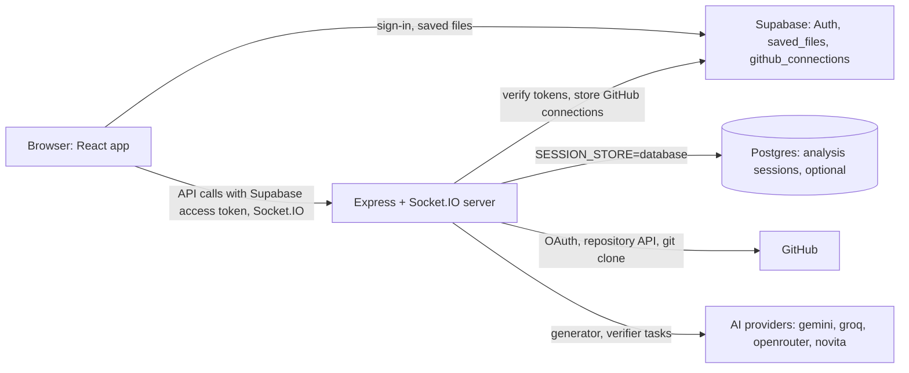

# InfraMind

InfraMind generates DevOps files for a GitHub repository. A signed-in user picks a repository; the server clones it, runs three agents in sequence (analyzer, generator, verifier) and returns a Dockerfile, a GitHub Actions workflow and a `.env.example`. The files can be downloaded or saved to the user's account.

## How it fits together



Source: `server/server.js`, `server/utils/auth.js`, `server/utils/githubConnections.js`, `server/utils/sessionStore.js`, `server/github.js`, `server/utils/git.js`, `server/ai/providers.js`, `client/src/lib/supabase.ts`, `client/src/lib/api.ts`.

Diagrams:

| Diagram | Where |
|---|---|
| System context | [ARCHITECTURE.md, section 1](ARCHITECTURE.md#1-system-context) |
| Sign-in and API authentication | [ARCHITECTURE.md, section 2](ARCHITECTURE.md#2-sign-in-and-api-authentication) |
| GitHub connection | [ARCHITECTURE.md, section 3](ARCHITECTURE.md#3-github-connection) |
| Analysis flow (clone, analyze, download) | [ARCHITECTURE.md, section 4](ARCHITECTURE.md#4-analysis-flow) and [README-AI-AGENTS.md](README-AI-AGENTS.md#analysis-flow) |
| Session status lifecycle | [ARCHITECTURE.md, section 5](ARCHITECTURE.md#5-session-lifecycle) |
| Data model | [ARCHITECTURE.md, section 6](ARCHITECTURE.md#6-data-model) |
| Agent pipeline | [README-AI-AGENTS.md](README-AI-AGENTS.md#agent-pipeline) |
| AI provider fallback | [README-AI-AGENTS.md](README-AI-AGENTS.md#ai-provider-fallback) |
| Deployment on Render | [DEPLOYMENT-GUIDE.md](DEPLOYMENT-GUIDE.md#deployment-on-render) |

## Features

- **Sign-in with Supabase Auth:** email and password, GitHub or Google (`client/src/lib/supabase.ts`). The server checks the Supabase access token on its account API routes (every `/api` route except `/api/metrics` and `/api/analytics`) and on Socket.IO connections (`server/server.js`, `server/utils/auth.js`, `server/utils/realtime.js`).
- **GitHub connection for repository access:** a separate GitHub OAuth App, run by the server, with scope `repo,user:email`. The token stays on the server, encrypted with AES-256-GCM (`server/github.js`, `server/utils/githubConnections.js`). Connected users can list their repositories and organizations and analyze private repositories they can access.
- **Analysis:** a shallow `git clone`, then the three agents. Only the generator and verifier call the AI layer, 3 to 7 calls per run. The analyzer reads the cloned files: the file list, the top-level manifests such as `requirements.txt`, `pyproject.toml` and `package.json`, and up to two existing Dockerfiles found at any depth, never `.env` files (`server/agents/index.js`, `server/agents/grounding.js`).
- **Checked output:** each generated file is extracted from the AI reply as one raw file and validated before it is saved; the workflow must be CI-only (read-only permissions, major-version action refs, no registry push). An invalid reply gets one repair attempt, then the file is left out with an error (`server/agents/files.js`).
- **Configurable AI providers:** per-task provider chains with retries and fallback; no provider or model is built in as the default (`server/ai/`).
- **Live progress:** Socket.IO `progress` events, delivered only to the session's owner (`server/utils/realtime.js`).
- **Results:** when an analysis completes, each generated file is shown in its own tab (Dockerfile, `ci.yml`, `.env.example`) as plain text with its line count, a Copy button and a Download button that names it `Dockerfile`, `ci.yml` or `.env.example` (Chrome drops the leading dot and saves `env.example`; the viewer says so). "Save to Account" stores the files in the `saved_files` table in Supabase in one insert; the button then reads "Saved" for that analysis until the page is reloaded. The verifier's review follows as plain text under "Review". All of this comes from one `GET /api/files/:sessionId` per completed analysis (`client/src/components/GeneratedFilesView.tsx`, `client/src/components/AgentProgress.tsx`, `client/src/lib/api.ts`).
- **Session storage:** in process memory or in Postgres through Prisma (`SESSION_STORE`, `server/utils/sessionStore.js`). Sessions expire 24 hours after creation.

## Technology

- **Client** (`client/`): React 18, TypeScript, Vite, Tailwind CSS with shadcn/ui components, React Router, `socket.io-client`, `@supabase/supabase-js` (`client/package.json`)
- **Server** (`server/`): Node.js (`^20.19 || ^22.12 || >=24.0`), Express 4, Socket.IO 4, Prisma 7 with the `pg` driver adapter, zod, helmet, express-rate-limit (`server/package.json`). Clones run the `git` binary through `child_process.execFile` (`server/utils/git.js`); `git` must be installed on the server.

## Quick start (local)

```bash
# From the repository root: installs root, client and server dependencies
npm run install:all

# Server configuration
cp server/.env.example server/.env
# Fill in at least: SUPABASE_URL, SUPABASE_ANON_KEY, GITHUB_TOKEN_ENC_KEY
# (openssl rand -base64 32), GITHUB_CLIENT_ID, GITHUB_CLIENT_SECRET, and for each
# provider in AI_PROVIDERS its <NAME>_API_KEY and <NAME>_MODEL.
# The example keeps SESSION_STORE=memory and GITHUB_TOKEN_STORE=memory.

# Client configuration
cp client/.env.example client/.env.local
# Fill in VITE_SUPABASE_URL and VITE_SUPABASE_ANON_KEY

# Run client and server together
npm run dev
```

`npm run dev` runs both through `concurrently` 10, whose `engines` require Node.js 22 or later (root `package.json`); on Node 20, start them separately with `npm run dev:client` and `npm run dev:server`.

The client runs on `http://localhost:5173` (`client/vite.config.ts`). The server listens on `PORT`, or 10000 without it (`server/utils/port.js`); 10000 is also the client's fallback for `VITE_API_URL` (`client/src/lib/api.ts`), `server/.env.example` and `render.yaml`. If you set another `PORT`, set `VITE_API_URL` to match.

Supabase setup (project, `saved_files` table, sign-in providers, redirect URLs), the GitHub OAuth App, database mode and production deployment are in [DEPLOYMENT-GUIDE.md](DEPLOYMENT-GUIDE.md).

## Configuration summary

The server refuses to start when a required setting is missing or invalid, and lists every problem at once, naming variables but never printing values (`startServer` in `server/server.js`, `server/utils/config.js`):

| Variable | Required | Notes |
|---|---|---|
| `SUPABASE_URL`, `SUPABASE_ANON_KEY` | yes | Used to verify user access tokens |
| `GITHUB_TOKEN_STORE` | yes | `memory` or `supabase` |
| `GITHUB_TOKEN_ENC_KEY` | yes | Standard base64 of exactly 32 bytes |
| `SUPABASE_SERVICE_ROLE_KEY` | with `GITHUB_TOKEN_STORE=supabase` | Used only for `public.github_connections` |
| `AI_PROVIDERS` | yes | Comma-separated: `gemini`, `groq`, `openrouter`, `novita` |
| `<NAME>_API_KEY`, `<NAME>_MODEL` | for every provider in a route | No default model IDs |
| `SESSION_STORE` | yes | `memory` or `database` |
| `DATABASE_URL` | with `SESSION_STORE=database` | Postgres connection string |
| `GITHUB_CLIENT_ID`, `GITHUB_CLIENT_SECRET` | yes | The repository-access OAuth App; the `.env.example` placeholders are refused |
| `GITHUB_REDIRECT_URI` | yes | Absolute http(s) URL ending in `/auth/github/callback`; https in production |
| `CLIENT_URL` | yes | The frontend origin (`scheme://host[:port]`, no path): always an allowed CORS origin, and the target of GitHub OAuth redirects; https in production |
| `PORT` | optional | 1-65535; default 10000 |
| `CORS_ALLOWED_ORIGINS` | optional | More allowed origins, comma-separated, each exactly `scheme://host[:port]` |
| `TRUST_PROXY` | optional | Number of reverse proxies in front of the server, 0-3; default 0 |
| `RATE_LIMIT_<NAME>_MAX` | optional | Count of one rate limit, 1-100,000 (see [API](#api)) |
| `GITHUB_TIMEOUT_MS` | optional | Timeout of GitHub API calls, 1000-60000; default 10000 |
| `METRICS_TOKEN` | optional | Enables `/api/metrics` and `/api/analytics`; 32+ characters, a shorter value is a startup error |
| `ANALYSIS_CONCURRENCY` | optional | Analyses running at once in this server process, 1-8; default 2 |
| `ANALYSIS_QUEUE_MAX` | optional | Analyses waiting for a slot, 0-100; default 20. When both are full, `POST /api/analyze` answers 503 `ANALYSIS_BUSY` |

Every variable is listed with comments in `server/.env.example`. The client reads `VITE_API_URL`, `VITE_SUPABASE_URL` and `VITE_SUPABASE_ANON_KEY` (`client/src/lib/api.ts`, `client/src/lib/supabase.ts`). Only the anon key belongs in the client: Vite bundles every `VITE_` variable into browser code.

The LLM key variable `LLAMA_API_KEY` from older versions of this README is not read anywhere.

## API

Every route registered in `server/server.js`:

| Method and path | Access | Purpose |
|---|---|---|
| `GET /health` | public | Liveness only: exactly `status: "ok"`, `timestamp`, `uptime`; queries no database or service |
| `GET /api/metrics` | `X-Metrics-Token` header equal to `METRICS_TOKEN` (32+ characters); otherwise 404 | Request, memory and CPU metrics, Node `version`, `environment`, `trackedSessions`, `analysisJobs` (`running`, `queued`) |
| `GET /api/analytics` | same as `/api/metrics` | Clone and analysis timings and outcomes of the last hour (at most 1,000 sessions) |
| `POST /api/github/connect` | Bearer | Issues a one-time ticket (2 minutes) to start a GitHub connection |
| `GET /auth/github` | public, needs a valid `ticket`; `oauth` limit | Sets the OAuth state cookie and redirects to GitHub |
| `GET /auth/github/callback` | public, needs the state cookie; `oauth` limit | Exchanges the code, redirects to `CLIENT_URL/auth/success?complete=<id>` |
| `POST /api/github/connect/complete` | Bearer | Claims the completion and stores the connection |
| `POST /auth/github/discard` | public; `oauth` limit | Discards an unclaimed completion and revokes its token; 204 |
| `GET /api/github/status` | Bearer | Whether the user has a GitHub connection; no GitHub API call |
| `DELETE /api/github/connection` | Bearer | Revokes the token at GitHub and deletes the connection |
| `GET /api/github/repositories` | Bearer and a GitHub connection; `githubProxy` limit | The user's repositories and organizations (`page`, `per_page`, default 50) |
| `GET /api/github/organizations/:org/repositories` | Bearer and a GitHub connection; `githubProxy` limit | An organization's repositories |
| `POST /api/github/verify-repo` | Bearer and a GitHub connection; `githubProxy` limit | Checks access to `owner`/`repo` |
| `POST /api/clone-repo` | Bearer; `clone` limit | Creates a session and clones `repositoryData` (connected repository) or `repoUrl` |
| `POST /api/analyze` | Bearer; `analysis` limit | Starts the agents on a `cloned` session and answers 202 `{ success, sessionId, status: "analyzing" }` at once; they run in the background, with a progress event after each agent. 400 when the session is not `cloned` (or another request claimed it first); 503 `{ error, code: "ANALYSIS_BUSY" }` with `Retry-After: 30` when every analysis slot and queue place is taken, and the session stays `cloned` for a retry |
| `GET /api/files/:sessionId` | Bearer, session owner | Generated files, tech stack, analysis, verification results |
| `GET /api/files/:sessionId/:filename` | Bearer, session owner | One generated file as a download. `filename` is `dockerfile`, `githubActions` or `envExample` (exact case), served as `Dockerfile`, `ci.yml` or `.env.example` (`Content-Disposition: attachment`) with `Content-Type: text/plain; charset=utf-8` and `X-Content-Type-Options: nosniff`. 404 `{ error: "File not found" }` for any other name or a file this run did not generate; 400 when the analysis has not completed. The browser does not call it: it downloads from the `GET /api/files/:sessionId` response it already holds |
| `GET /api/status/:sessionId` | Bearer, session owner | Status, timestamps and error of a session; the client polls it every 5 s while an analysis runs, in case progress events are missed |

"Bearer" means `Authorization: Bearer <Supabase access token>`: `app.use('/api', requireUser(verifier))` is registered after `/api/metrics` and `/api/analytics` and before every other `/api` route. Without a valid token these answer 401 `AUTH_REQUIRED`, or 503 `AUTH_UNAVAILABLE` when Supabase cannot be reached (`server/utils/auth.js`). A session that does not exist or belongs to someone else answers 404 "Session not found".

Rate limits (`server/utils/config.js` `RATE_LIMITS`, `server/utils/security.js`, `server/server.js`):

| Name | Applies to | Counted per | Default |
|---|---|---|---|
| `preAuth` | every `/api` request, before the token is checked (including `/api/metrics` and `/api/analytics`) | client IP | 300 per 5 minutes |
| `user` | every `/api` request after the token check | user | 120 per minute |
| `githubProxy` | the repositories, organization repositories and verify-repo routes | user | 60 per minute |
| `clone` | `POST /api/clone-repo` | user | 10 per 10 minutes |
| `analysis` | `POST /api/analyze` | user | 5 per 5 minutes |
| `oauth` | `GET /auth/github`, `GET /auth/github/callback` and `POST /auth/github/discard`, one shared count | client IP | 30 per 10 minutes |
| `socketHandshake` | Socket.IO connections, before the token is checked | client IP | 60 per minute |

A limited request answers 429 `{ error, code: "RATE_LIMITED" }` with `RateLimit-Limit`, `RateLimit-Remaining`, `RateLimit-Reset` and `Retry-After` headers; a limited Socket.IO connection gets `connect_error` `RATE_LIMITED`. `RATE_LIMIT_<NAME>_MAX` (for example `RATE_LIMIT_PREAUTH_MAX`) changes a count; the windows are fixed, and no setting switches limiting off. The client IP is the socket address, or with `TRUST_PROXY=n` the address `n` proxies back in `X-Forwarded-For`. IPv6 clients are counted per /56 prefix, so rotating addresses inside one network does not reset a limit; IPv4 (and IPv4-mapped IPv6) addresses are counted one by one, and an address that cannot be parsed falls into one shared bucket (`rateLimitKeyForIp` in `server/utils/security.js`). The counters live in the server process's memory: each instance counts on its own, and a restart resets them.

GitHub-backed routes (repositories, organization repositories, verify-repo, and the access check of `POST /api/clone-repo` with `repositoryData`) answer 503 `{ error: "GitHub rate limit reached. Please try again later.", code: "GITHUB_RATE_LIMITED" }` with `Retry-After` when GitHub rate-limits the user, and 504 `{ error: "GitHub did not respond. Please try again.", code: "GITHUB_UNAVAILABLE" }` when GitHub does not answer within `GITHUB_TIMEOUT_MS` or cannot be reached. A rate limit is never reported as "no access", and the clone request creates no session (`server/github.js`, `server/server.js`).

There is no `POST /api/devpilot` route in `server/server.js`. Sign-up, sign-in and saved files go from the browser to Supabase directly, not through the server.

Socket.IO: connect with `auth: { token }`, then emit `subscribe` with `{ sessionId }`; the server emits `progress` and, when the token expires, `auth_expired` (`server/utils/realtime.js`). A handshake from a browser origin that is not allowed is refused, and handshakes are counted per IP before the token is checked (`server/server.js`).

## Repository layout

```
client/                 React app (pages in src/pages, routes in src/App.tsx)
server/server.js        Express + Socket.IO server (npm start)
server/agents/          The three agents
server/ai/              AI provider layer
server/utils/           Auth, GitHub connections, git, sessions, realtime, security, logging
server/prisma/          Prisma schema and migration for the session tables
supabase/migrations/    SQL for public.github_connections
render.yaml             Render services
```

`server/index.js`, `server/minimal.js`, `server/test-render.js` and `server/start.js` are not part of the running server; see [ARCHITECTURE.md, section 9](ARCHITECTURE.md#9-code-that-is-not-part-of-the-running-system).

## Tests

```bash
cd server && npm test      # node --test suite in server/test/
cd client && npm run build # tsc and vite build
cd client && npm run lint
```

## License

There is no license file in this repository. `server/package.json` declares `"license": "MIT"`.

## Other documents

- [ARCHITECTURE.md](ARCHITECTURE.md): components, flows, data model
- [README-AI-AGENTS.md](README-AI-AGENTS.md): agents and AI providers
- [DEPLOYMENT-GUIDE.md](DEPLOYMENT-GUIDE.md): Supabase, GitHub OAuth App, database, Render
- [PRODUCTION-CHECKLIST.md](PRODUCTION-CHECKLIST.md): checks before going live
- [server/OBSERVABILITY.md](server/OBSERVABILITY.md): logs, health, metrics, AI call records
- [server/README.md](server/README.md): server scripts and layout
- [IMPROVEMENTS.md](IMPROVEMENTS.md): historical record of an earlier round of changes
